# See the krypton apps before you install them

> [!IMPORTANT]
> **Bottom Line Up Front (BLUF):** These twelve pictures show krypton, vibey's apps for phone,
> web, desktop and VS Code. They are **design mockups**: hand-written HTML rendered in headless
> Chrome by `scripts/generate_screenshots.py`, not captures of the running apps. Use them to see
> the intended look; read each caption for what the real screen does today. Regenerating them
> takes one command and a Chrome install.

## The lesson

Daniel was scrolling the gallery on his phone and stopped at the usage screen.

**Daniel:** Professor, this says 96% used and resets Tuesday at two. Is that my usage?

**Professor Feynman:** No. Think of an architect's drawing of a house that is still being built.
It shows where the windows go. It does not tell you whether the plumbing works.

**Daniel:** So these are drawings, not photographs.

**Professor Feynman:** Exactly. The script that makes them writes a little web page for each
screen by hand and takes its picture in Chrome. Nothing in them comes from a running vibey.

**Daniel:** Then why look at them at all?

**Professor Feynman:** To see the intended look before you install anything, and to know what
to look for. The gap is what matters: some real screens already talk to your vibey hub, and
some still show fixed numbers. The captions below say which, and point at the file you can read
to check.

**Daniel:** And the 96%?

**Professor Feynman:** A number typed into the real usage screen too. It is not measured
anywhere yet. That is the picture's limit, and the screen's.

## Do it

1. Look through the pictures below. Each caption has two parts: what the picture shows, and
   what the real app does today, with the source file.
2. To see a real app, install it: [Install every krypton app](install.md) and
   [Downloads](downloads.md).
3. To rebuild the pictures, from the top of a vibey checkout, with Google Chrome or Chromium
   installed:

   ```bash
   python3 scripts/generate_screenshots.py
   ```

   You should see one `✓ Generated NN-name.png (WIDTHxHEIGHT)` line per screen, then
   `Successfully generated 12 screenshots in screenshots/ and docs/img/screenshots/`.

## Daniel's teach-back

**Daniel:** The gallery shows mockups: web pages written by hand for each screen and
photographed by headless Chrome. They show the look the apps aim for, not my data and not
always what the app does. The real phone screens for chat, projects, gates and pairing talk to
the hub; the usage and settings screens still show fixed values. I can rebuild every picture
with `scripts/generate_screenshots.py`.

**Professor Feynman:** Right. And the desktop pictures are HTML too, not the GTK app: the real
desktop app is drawn by GTK 4 and libadwaita, and its screens differ.

## The pictures

### Mobile and web (`clients/app`)

The real app is built with React Native and Expo for iOS, Android and the web, and pairs with
your vibey hub ([ADR-0071](../architecture/decisions/0071-hub-pairing-and-trust.md)).

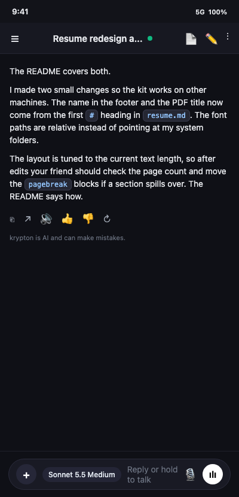{ width="320" }

**Chat.** Mockup: a conversation with inline token pills, a Copy, Share, TTS, Feedback and
Retry bar, and a composer with a model picker. Real app: `clients/app/src/screens/chat.tsx`
talks to the hub; five of its buttons have no action yet (`onPress={() => {}}`).

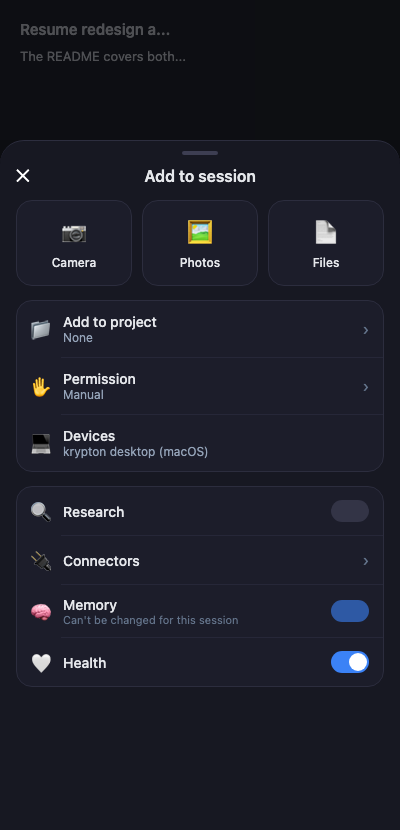{ width="320" }

**Add to session.** Mockup: a bottom sheet with Camera, Photos and Files, a project and device
picker, and Research, Connectors, Skills, Memory and Health switches. Real app:
`add-session-modal.tsx`. Whether each switch reaches vibey was not verified for this page.

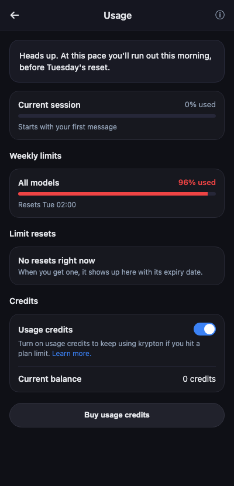{ width="320" }

**Usage and limits.** Mockup: usage bars, reset times and a usage-credits switch. Real app:
`usage.tsx` shows the same **fixed** values ("96% used", "Resets Tue 02:00", "0 credits"), and
**Buy usage credits** does nothing. vibey has no usage telemetry or plan limits behind it.

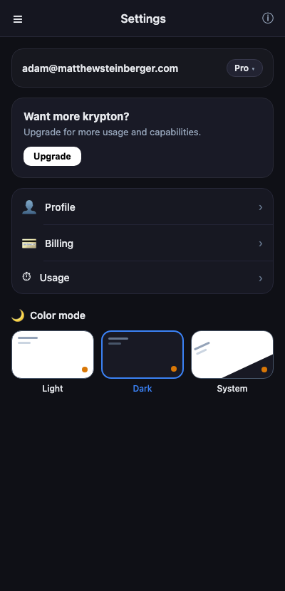{ width="320" }

**Settings.** Mockup: an account card with a Pro badge, an upgrade card, capabilities and
connectors, and a Light, Dark or System picker. Real app: `settings.tsx` has the theme picker;
its account card, Pro badge and upgrade card are fixed placeholders, and eight of its buttons
have no action yet. vibey has no paid plan.

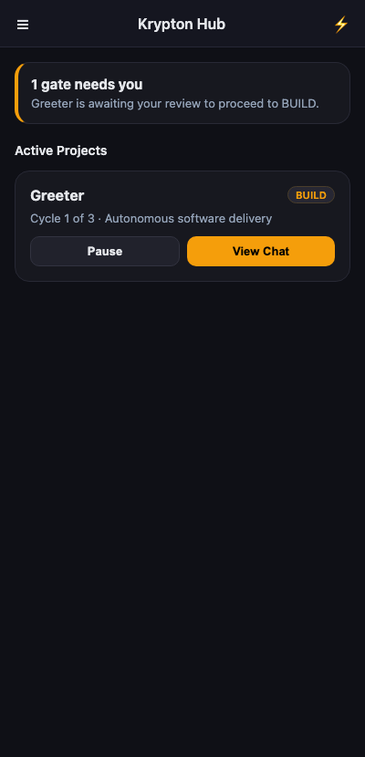{ width="320" }

**Home.** Mockup: projects with their cycle progress and alerts for gates. Real app:
`home.tsx` lists projects from the hub.

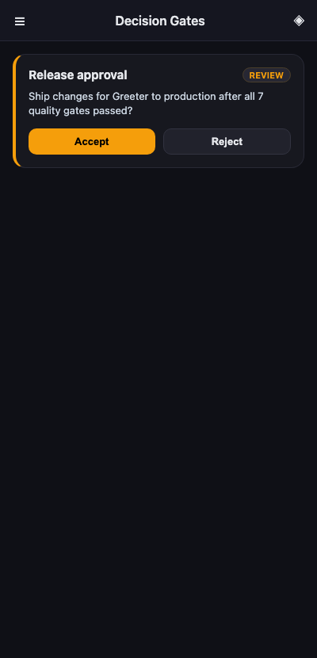{ width="320" }

**Gates.** Mockup: the questions a project has parked for you. Real app: `gates.tsx` reads and
answers gates through the hub. A paired device answers only what its scopes allow; a spending
gate needs the `spend` scope.

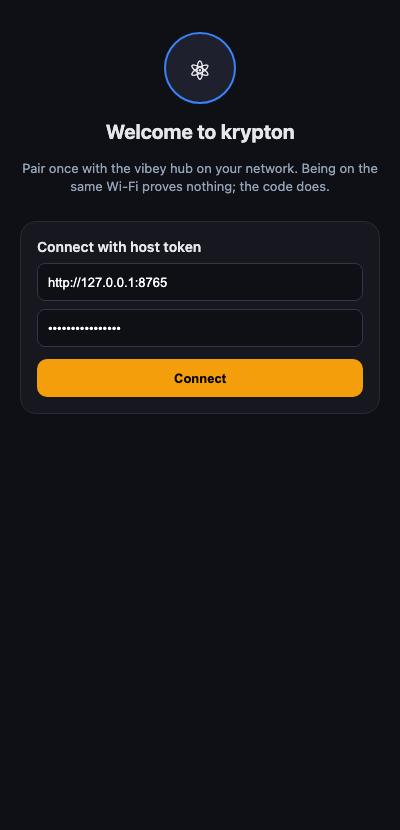{ width="320" }

**Pair.** Mockup: pairing with the hub by QR code or host token. Real app: `pair.tsx`. On the
host, `vibey hub pair --scope view --scope answer` shows the QR code and a 6-digit code the
device claims within two minutes.

### Desktop (`clients/desktop`)

The real desktop app is written in C on GTK 4 and libadwaita, for Linux and macOS. The three
pictures below are HTML mockups, not the GTK app.

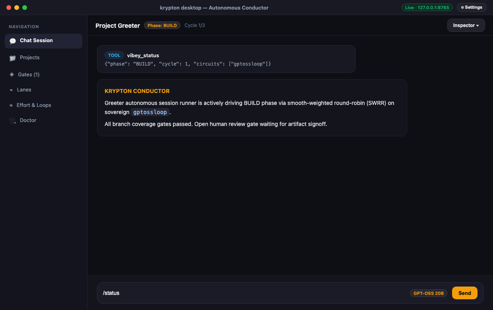

**Chat.** Mockup: a session with a navigation sidebar, a hub connection pulse, tool cards and a
model picker. Real app: `clients/desktop/src/app/kr-chat-page.c`; its chat verbs, in
`src/core/kr-chat.c`, are `/new`, `/status`, `/gates`, `/answer`, `/start`, `/pause` and
`/abandon`.

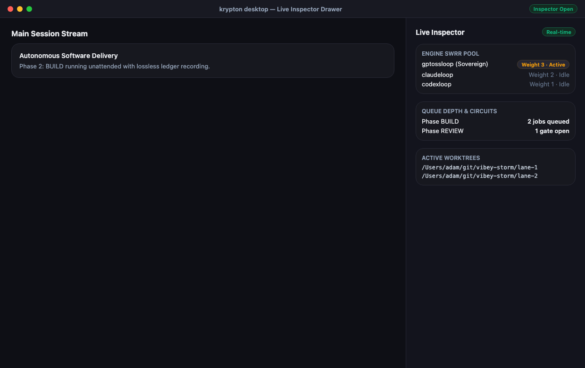

**Inspector.** Mockup: engine pools, queue depths per phase, worktrees and ledger events. Real
app: `kr-inspector.c` has Environment, Worktree, Remote Control, Context, Connectors (MCP) and
Changes sections. Its connector list is fixed sample names, and **Create PR** only shows a
message. It does not show engine pools or queue depths.

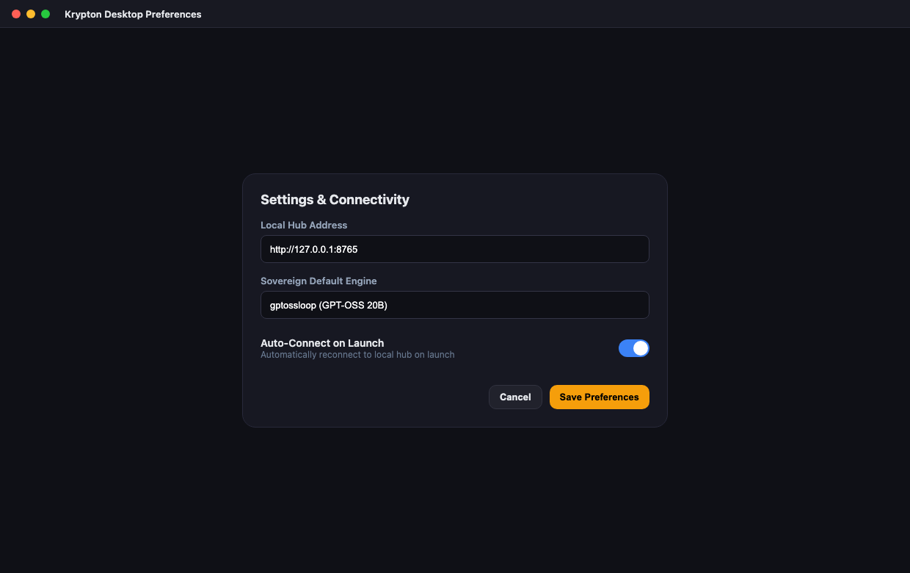

**Preferences.** Mockup: engine preferences, the sovereign GPT-OSS default, hub connection and
auto-connect. Real app: `kr-settings-dialog.c`.

### VS Code (`clients/vscode`)

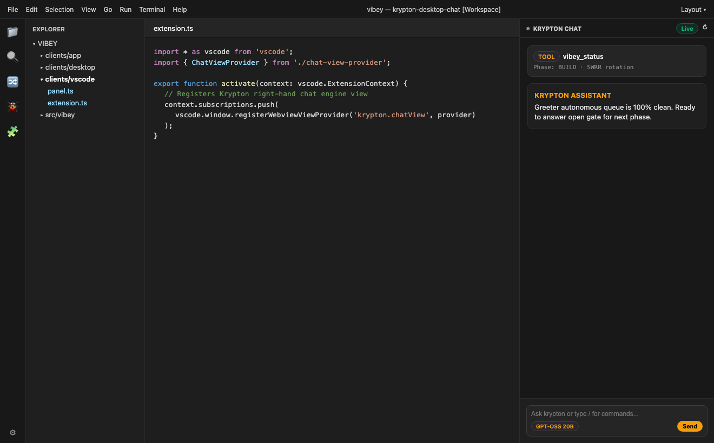

**The krypton panel.** Mockup: krypton docked in the editor, with tool calls and a model picker.
Real extension: the chat-first **krypton** view in the secondary sidebar, plus the task panel;
see [VS Code extension](vscode-extension.md). The script also writes `12-vscode-composer.png`,
which is the same HTML as this picture, so it is not shown.

## The details

| Fact | Value |
|---|---|
| Generator | `scripts/generate_screenshots.py` (`ScreenshotGenerator`) |
| How | One hand-written HTML page per screen, rendered by `--headless --screenshot` in Chrome or Chromium |
| Screens | 12: seven mobile at 400x830, three desktop at 1240x780, two VS Code at 1320x820 |
| Output | `screenshots/` at the top of the checkout, copied into `docs/img/screenshots/` |
| Chrome it looks for | `/Applications/Google Chrome.app`, `/Applications/Chromium.app`, then `google-chrome`, `chromium`, `chromium-browser` on PATH |
| Not pictured | the hub's own front door at `http://127.0.0.1:8765/`, and Zed over ACP |

## When it goes wrong

| What you see | What it means | What to do |
|---|---|---|
| `FileNotFoundError` naming `/Applications/Google Chrome.app/...` | No Chrome or Chromium was found, so the script tried its first guess | Install Google Chrome or Chromium, or put `chromium` on PATH |
| A picture shows `Krypton Screen` and nothing else | The screen has no HTML builder yet (`_html_fallback`) | Add a `_html_<app>_<screen>` method for it |
| The real app looks different from a picture | The pictures are mockups | Trust the app; the captions say what it does |

## Where next

- [Install every krypton app](install.md): get the real apps on your devices.
- [VS Code extension](vscode-extension.md): the one krypton surface you can use today without a
  hub.
- [Drive a project](drive-a-project.md): what each surface can do with a running project.

## Say it in one line

The krypton gallery shows hand-made mockups of the phone, desktop and VS Code apps; the captions say what each real screen does today.
