# Visual Tour & Screenshots

<!-- Generated from automated screenshots captured via scripts/generate_screenshots.py -->

Krypton is the user interface family for **vibey**, delivering autonomous software engineering from your phone, your desktop, or your code editor. Every screen is designed with intentional craft, dark-mode surfaces, live telemetry, and zero human blocking.

---

## 📱 Krypton Mobile & Web App (`clients/app`)

Built with React Native and Expo (SDK 57) for iOS, Android, and Web browsers. It connects securely to the local or remote vibey hub with zero human stall.

### Frontier Chat Interface & "Add to session"

<div style="display: flex; gap: 16px; flex-wrap: wrap; margin-bottom: 24px;">
  <div style="flex: 1; min-width: 320px; max-width: 380px;">
    <h4>Frontier Chat Experience</h4>
    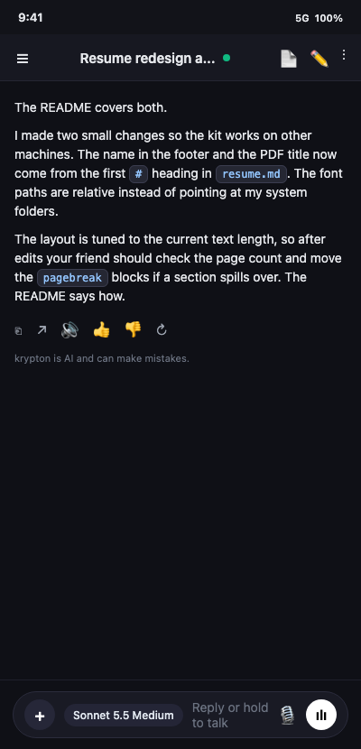
    <p><em>Conversational transcript with inline token pills (<code>resume.md</code>, <code>#</code>, <code>pagebreak</code>), quick action bar (Copy, Share, TTS, Feedback, Retry), and floating composer with model selection and audio controls.</em></p>
  </div>
  <div style="flex: 1; min-width: 320px; max-width: 380px;">
    <h4>"Add to session" Modal</h4>
    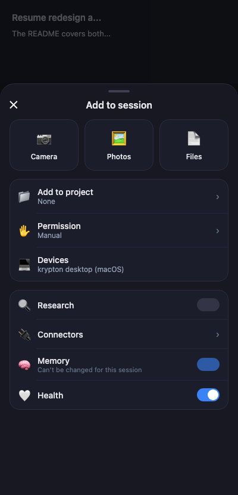
    <p><em>Bottom sheet modal with Camera, Photos, and Files tiles, project selection, device routing, and toggles for Research, Connectors, Skills, Memory, and Health.</em></p>
  </div>
</div>

### Usage Telemetry & Settings

<div style="display: flex; gap: 16px; flex-wrap: wrap; margin-bottom: 24px;">
  <div style="flex: 1; min-width: 320px; max-width: 380px;">
    <h4>Usage & Limits</h4>
    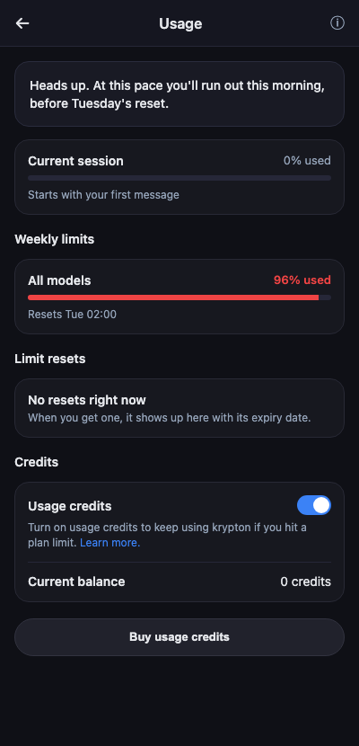
    <p><em>Real-time pace warnings, current session progress, weekly limits with reset timers, and usage credit toggles.</em></p>
  </div>
  <div style="flex: 1; min-width: 320px; max-width: 380px;">
    <h4>Settings & Theme Switcher</h4>
    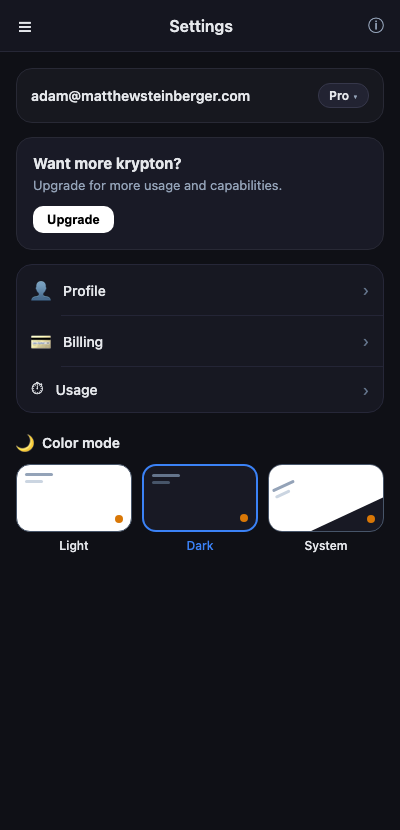
    <p><em>Pro badge header, upgrade card, capabilities and connectors lists, and 3-card visual Color Mode selector (Light, Dark, System).</em></p>
  </div>
</div>

### Projects, Decision Gates & Pairing

<div style="display: flex; gap: 16px; flex-wrap: wrap; margin-bottom: 24px;">
  <div style="flex: 1; min-width: 320px; max-width: 380px;">
    <h4>Home Dashboard</h4>
    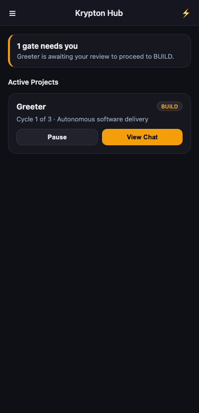
    <p><em>Active project orbitals, cycle progress, and human intervention alerts.</em></p>
  </div>
  <div style="flex: 1; min-width: 320px; max-width: 380px;">
    <h4>Human Decision Gates</h4>
    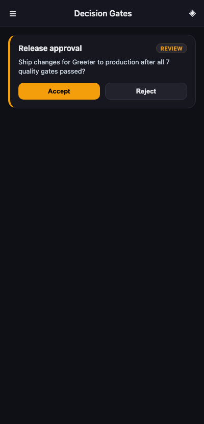
    <p><em>Review gates requiring human sign-off before entering BUILD or deployment.</em></p>
  </div>
  <div style="flex: 1; min-width: 320px; max-width: 380px;">
    <h4>Device Pairing</h4>
    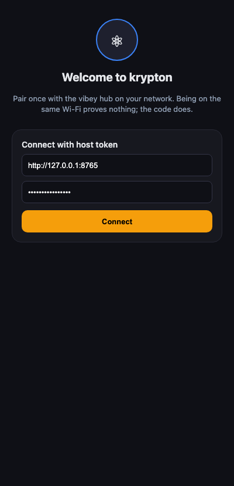
    <p><em>Zero-trust pairing with the local vibey hub via QR code or host token.</em></p>
  </div>
</div>

---

## 🖥️ Krypton Desktop App (`clients/desktop`)

Native desktop application for macOS and Linux (GTK 4 and libadwaita).

### Main Workspace & Live Inspector

<div style="margin-bottom: 24px;">
  <h4>Desktop Chat Session</h4>
  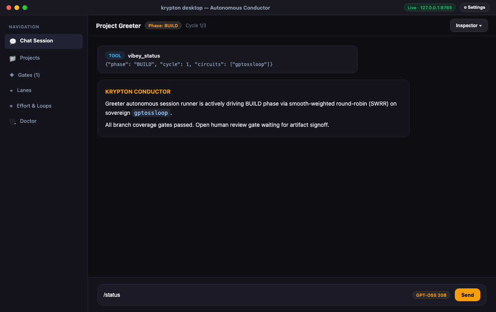
  <p><em>Desktop session runner with full navigation sidebar, live hub connectivity pulse, structured tool execution cards, and model selector.</em></p>
</div>

<div style="margin-bottom: 24px;">
  <h4>Live Telemetry & Inspector Drawer</h4>
  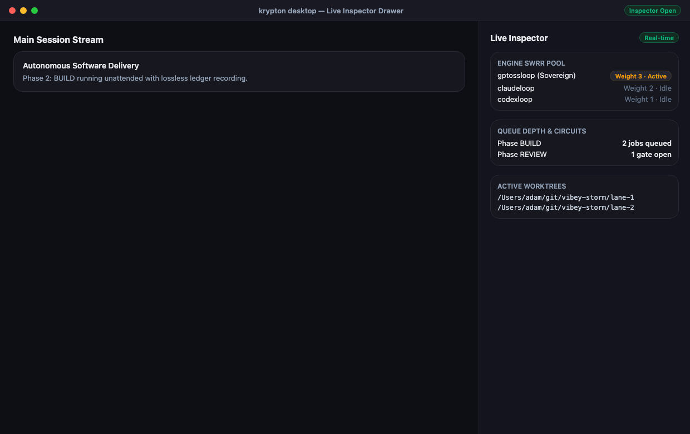
  <p><em>Side-panel inspector detailing smooth-weighted round-robin (SWRR) engine pools, queue depths across delivery phases, active worktree directories, and real-time ledger events.</em></p>
</div>

<div style="margin-bottom: 24px;">
  <h4>Desktop Preferences Dialog</h4>
  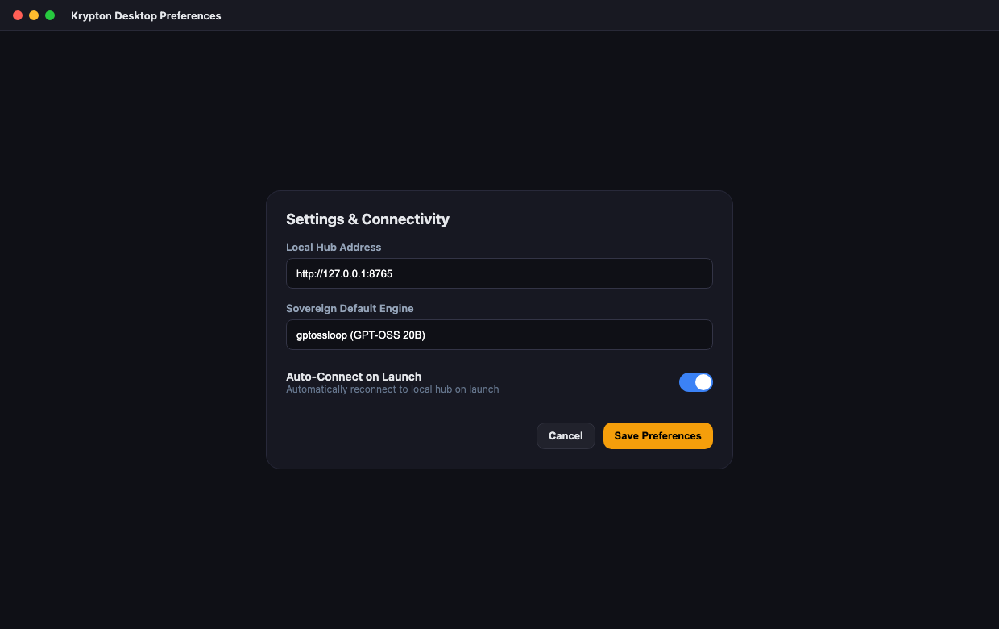
  <p><em>Engine preferences, sovereign GPT-OSS default toggles, hub connectivity, and auto-connect settings.</em></p>
</div>

---

## 🧩 Krypton VS Code Extension (`clients/vscode`)

Right-side chat participant and steering engine for VS Code, VSCodium, and Cursor.

<div style="margin-bottom: 24px;">
  <h4>VS Code Right-Hand Chat Participant</h4>
  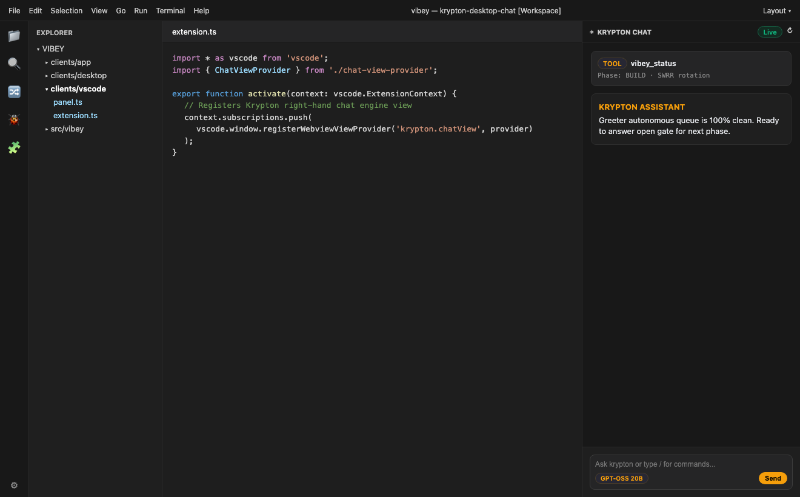
  <p><em>Integrated editor experience with Krypton docked on the right side, showing tool calls, model picker, and phase coordination while you edit code.</em></p>
</div>

---

## 🚀 Regenerating Screenshots

To regenerate all screenshots across the entire codebase at any time, run:

```bash
python3 scripts/generate_screenshots.py
```

This renders every screen into `screenshots/` and synchronizes the assets into `docs/img/screenshots/`.
