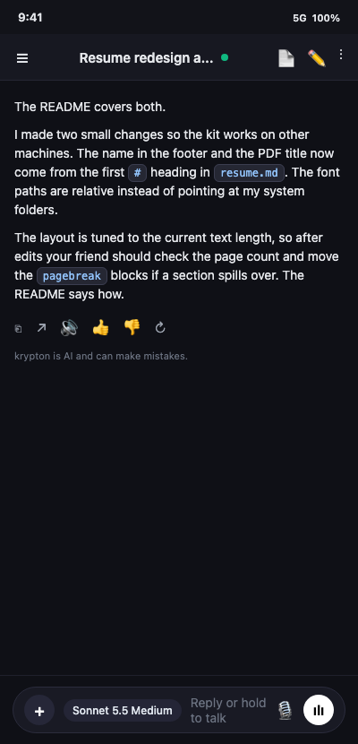
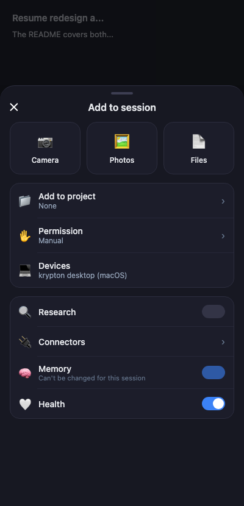
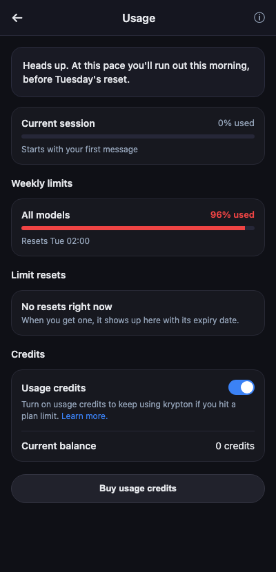
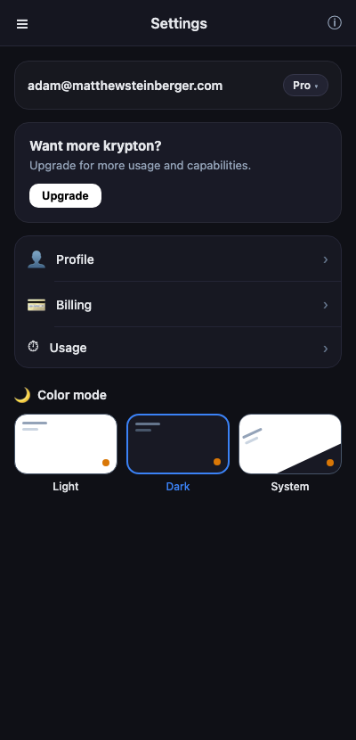
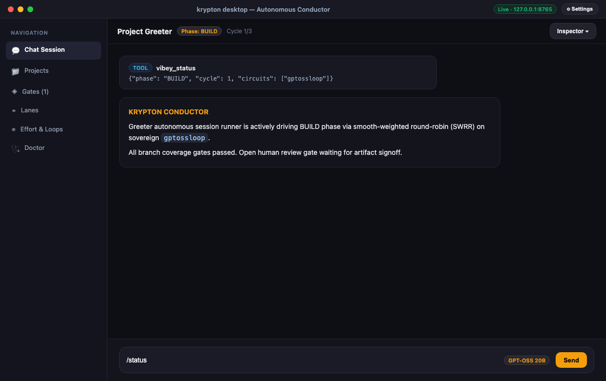
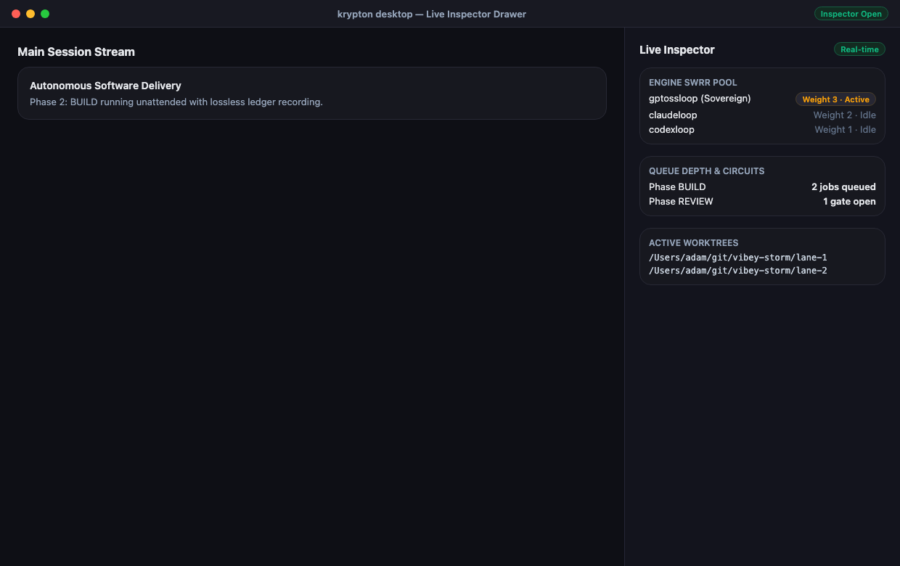
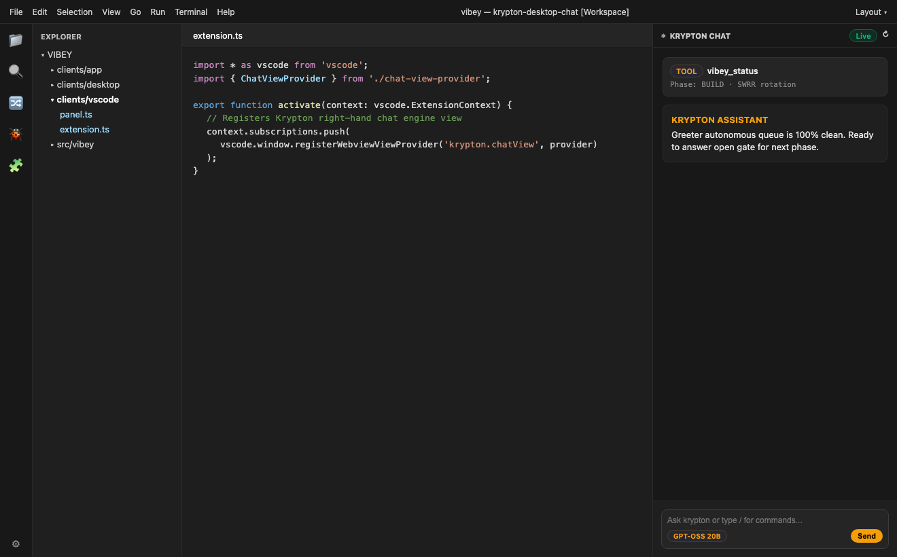

# vibey — open-source orchestration for AI coding agents

AI coding agents can write the code. Getting it delivered still takes a person:
re-prompting an agent that lost the thread, re-explaining everything after a crash,
restarting the run when one vendor's credits give out at 2 a.m.

**vibey is a free, open-source orchestrator for AI coding agents**: a program that runs a team
of them for you, the way a project manager runs a team. It interviews you until the
specification is precise, builds unattended on agents that run on your own machine first and on
paid ones only if you allow them, stops only for the decisions that are yours, and writes every
step to a ledger in PostgreSQL that can only be added to, so a crashed or out-of-credit agent's
work is picked up again rather than lost.

**Who it is for**, in this order ([ADR-0087](architecture/decisions/0087-the-six-audiences-in-order.md)): FOSS developers who already use
Claude Code, Codex or a local model, want finished, reviewed work rather than one session at a
time, and may build vibey with us; freelancers and freelance clients, who need fixed-scope delivery
with hard budget caps; universities and
academia, who can study and cite a working design for durable, auditable agent orchestration
([the paper](https://the-vibey-project.github.io/vibey/main/paper/)); governments and their militaries, who can
[keep a record that cannot be quietly rewritten](guides/outcomes/keep-a-tamper-evident-record.md); non-profit
orgs and other small mission-driven teams, who can
[cap what agents spend](guides/outcomes/cap-agent-spending.md) and
[run them on their own hardware](guides/outcomes/run-agents-on-your-own-hardware.md)
([the non-profit demo](guides/demos/non-profit.md)); and industry teams. Each audience is meant to have its own demo; the non-profit one is written, and the other five are not yet.

**The mission:** a free, open, censorship-free replacement for Claude Code and Codex that writes
code the way a principal software engineer does, and in time an autonomous general intelligence.
That is where the project is going, not what it does today: today vibey drives Claude Code,
Codex and a local model rather than replacing them
([why](#does-vibey-replace-claude-code-or-codex)), and its own scorecard measures how far it
still is from running without a person ([Status](#status)).

**Never written code?** You can still read this. *Code* is text files of
instructions computers run; an *AI coding agent* is a program that writes and
edits that code from plain-English requests; *deploying* means putting the
finished software somewhere people can use it. vibey's job is to manage a
team of those agents from your first description to deployed software, the
way a project manager runs a team — asking you questions up front, checking
the work, and only interrupting you when a decision is truly yours.

<!-- standard-block:install:start -->
> [!IMPORTANT]
> **Bottom Line Up Front (BLUF):** One command installs vibey and gets a new macOS or Linux
> machine ready to run a first project on your own hardware. About 15 minutes, plus the model
> download of roughly 12 GB.
>
> ```bash
> curl -fsSL https://raw.githubusercontent.com/the-vibey-project/vibey/main/scripts/install.sh | sh -s -- --full
> ```
>
> It installs `uv` and Python if you lack them, then vibey with its hub, PostgreSQL, a local
> database, Ollama, the default model, and the connection to your editors, and ends by running
> `vibey doctor`. Each step is announced first and can be skipped (`VIBEY_FULL_POSTGRES=0`,
> `VIBEY_FULL_DATABASE=0`, `VIBEY_FULL_OLLAMA=0`, `VIBEY_FULL_MODEL=0`, `VIBEY_FULL_CONNECT=0`).
> On Linux it asks for your sudo password, and on macOS it needs Homebrew. Run it again to repair
> an install.
>
> **Afterwards, two things are yours:** add the `export VIBEY_PG_URL=...` line it prints to your
> shell profile, and require `scram-sha-256` in `pg_hba.conf` (`vibey doctor` says so until you do).
> Without `--full`, the same command installs only vibey, and `vibey doctor` lists what is missing.
<!-- standard-block:install:end -->

<!-- remove-after-release:start -->
**Until the next release:** `--full` calls commands added in pull request #1978, so it works from the release after that one. Until then the plain `install.sh | sh` form installs only vibey, without the hub; follow [Set it up by hand](#set-it-up-by-hand) for the rest.
<!-- remove-after-release:end -->

<!-- standard-block:llm-driver:start -->
> [!IMPORTANT]
> **Bottom Line Up Front (BLUF):** Four steps let Claude Code run your vibey projects: start the
> hub, say where projects live, connect Claude Code, and ask it. About 5 minutes after the install.
>
> 1. **Start the hub** in a terminal where `VIBEY_PG_URL` is exported (the installer printed the
>    line): `vibey hub start`
> 2. **Say where projects live.** Add this to your own `vibey.toml` (macOS:
>    `~/Library/Application Support/vibey/vibey.toml`, Linux: `~/.config/vibey/vibey.toml`):
>    `[hub]` then `projects_root = "~/vibey-projects"`. Without it, starting a project from the
>    LLM is refused.
> 3. **Connect Claude Code** from the folder you will work in:
>    `vibey connect --client claude_code --yes`. It writes `./.mcp.json` there and saves the old
>    file as `.vibey.bak`. Leave out `--client` and it writes the config for every client it knows.
> 4. **Ask.** Run `claude` in that folder, approve the `vibey` server, and type: *Use the vibey
>    tools: list my vibey projects and any open gates, then tell me what each one is waiting on.*
>
> Claude Code gets 16 tools: start a project, start work, pause work, abandon a project, list
> projects, status, gates, answer a gate, queue, ledger, budget, lanes, loops, doctor, and search
> and fetch the web through the hub. The hub refuses it the gates that spend
> money, and its instructions say to abandon a project only after you confirm. One known gap: over
> MCP it can answer the deployment opt-in gate, which asks "deploy or stay local"; only ACP refuses
> that ([`SECURITY.md`](https://github.com/the-vibey-project/vibey/blob/develop/SECURITY.md)). Codex, Cursor, VS Code,
> Claude Desktop, Gemini CLI and any ACP client such as Zed work the same way through
> `vibey connect --client <name>` or `vibey acp`.
<!-- standard-block:llm-driver:end -->

Each of those, step by step and with what to do when a step fails:
[the install guide](guides/install.md), and
[drive vibey from another LLM](guides/drive-from-an-llm.md).

> It was raining, and Daniel came in shaking his umbrella and holding a question.
>
> **Daniel:** Professor, the coding agents already write code. What is vibey for?
>
> **Professor Feynman:** Picture a building site. You have good bricklayers. Who decides what
> gets built, in what order, and who checks that the wall is straight?
>
> **Daniel:** The project manager.
>
> **Professor Feynman:** That is vibey. It questions you until the plan is clear, hands each
> piece to a coding agent, one on your own machine first, checks the work, and comes back to
> you only for what is yours: the design, the review, deploying, and money.
>
> **Daniel:** And if a worker walks off halfway, or runs out of credit?
>
> **Professor Feynman:** Then the site diary saves you. Every question, answer, decision and
> handoff is written in it first, and you may only add lines, never change one. The next
> worker reads the diary and starts where the last one stopped.
>
> **Daniel:** So the work lives in the diary, not in any one agent's head.
>
> **Professor Feynman:** Yes. The picture stops in one place: a paper diary is only as honest as
> whoever holds the pen. This one is a ledger in PostgreSQL that refuses every change and
> deletion, with a chain of fingerprints that shows if anyone tried.
>
> **Daniel's teach-back:** vibey is a project manager for coding agents. It questions me until
> the specification is exact, gives the work to agents, local ones first, and checks it. It
> stops only for my decisions. Every step goes into a ledger that can only grow, so when an
> agent fails, the next one carries on from the ledger.
>
> **Professor Feynman:** Right, with one thing to add: checking is not approving. The review is
> yours, and nothing is deployed unless you say so.

*The conversations between Professor Feynman and his student Daniel on this site are written for
this documentation; they are not quotations from the real Richard Feynman.*

**What makes it different** — each claim links to what proves it:

- **A crash loses no job.** Jobs are held under expiring leases and reclaimed when a worker dies. A [chaos test](https://github.com/the-vibey-project/vibey/blob/develop/tests/infrastructure/db/test_chaos.py) runs 8 workers through 500 jobs, abandoning each claim with probability 0.2, and passes only if no job is lost or committed twice — [the case study](case-studies/how-vibey-survives-a-crashed-agent.md) tells how.
- **The record cannot be quietly rewritten.** The database refuses every update and delete to the ledger ([ADR-0055](architecture/decisions/0055-the-ledger-is-append-only-by-the-database.md)), and a SHA-256 hash chain over its events makes any edit visible ([`ledger_chain.py`](https://github.com/the-vibey-project/vibey/blob/develop/src/vibey/domain/ledger_chain.py)). **See one for yourself in the [ledger explorer](explorer/index.md)**: a public, searchable view of a real project's ledger, where your browser checks each record's digest.
- **Local first, paid by choice.** The default engine runs the Heretic v2 build of GPT-OSS 20B on your own machine through Ollama ([ADR-0064](architecture/decisions/0064-gptossloop-is-the-sovereign-engine.md), [ADR-0099](architecture/decisions/0099-heretic-v2-of-gpt-oss-20b-is-the-sovereign-default-model.md)); a paid engine runs only when no local one can ([ADR-0038](architecture/decisions/0038-local-engines-are-preferred-first.md)).
- **You decide what matters.** Design, review and deployment wait for your recorded answer, and a waiting question parks its job instead of blocking a worker ([ADR-0009](architecture/decisions/0009-human-gates-are-parked-jobs.md)).
- **Held to gates it cannot talk its way past.** vibey's four code layers each need 100% branch coverage to merge ([ADR-0023](architecture/decisions/0023-four-layers-four-floors.md)), every hard call is argued in a [decision record](https://github.com/the-vibey-project/vibey/tree/develop/docs/architecture/decisions/) (105 ADRs), and releases publish through PyPI trusted publishing with no stored token ([`vibey-engine.yml`](https://github.com/the-vibey-project/vibey/blob/develop/.github/workflows/vibey-engine.yml)).

**See a real ledger** — no install, no account: [open the ledger explorer](explorer/index.md), search every public decision, finding and phase change of a real project, and check each record yourself.

The full setup is under [Install](#install), then [Quickstart](#quickstart). Came with a
specific problem? [What do you want to do?](guides/outcomes/index.md) answers six,
from running agents on your own hardware to capping what they spend.

**Contribute in your first hour.** Clone, `uv sync --extra dev`, run one test, make one
small change: [the first-hour guide](https://github.com/the-vibey-project/vibey/blob/develop/CONTRIBUTING.md#your-first-hour) walks it command
by command, from a [good first issue](https://github.com/the-vibey-project/vibey/issues?q=is%3Aissue+is%3Aopen+label%3A%22good+first+issue%22)
to your pull request. The project governs itself by written law — start with
[the Constitution](https://the-vibey-project.github.io/vibey/main/governance/constitution/).

---

[](https://pypi.org/project/vibey-engine/)
[](https://pypi.org/project/vibey-engine/)
[](https://pypi.org/project/vibey-engine/)
[](https://github.com/the-vibey-project/vibey/actions/workflows/ci.yml)
[](https://github.com/the-vibey-project/vibey/blob/develop/LICENSE)
[](https://the-vibey-project.github.io/vibey/main/)
[](https://the-vibey-project.github.io/vibey/main/paper.pdf)
[](https://the-vibey-project.github.io/vibey/main/book.pdf)

**Prefer to read first?** The design is a research paper — [PDF](https://the-vibey-project.github.io/vibey/main/paper.pdf) · [HTML](paper.md) —
and the whole documentation is a book — [PDF](https://the-vibey-project.github.io/vibey/main/book.pdf) · [EPUB](https://the-vibey-project.github.io/vibey/main/book.epub) · [print](https://the-vibey-project.github.io/vibey/main/book-print.html).

The project and its engine are **vibey**; every app and interface a person uses is
**krypton** (sub-doctrine 9.e), whose emblem is the krypton atom: krypton-84, four shells.

For the precise version: a queue-based, six-phase conductor for autonomous
software delivery — with an optional visual-design interstitial and opt-in
Azure deployment — built on top of the [`*loop` autonomous session
runners](https://github.com/the-vibey-project/vibey/tree/develop/src/vibey_runners/), which live in this repository as uv
workspace members (ADR-0021).

## What problem this solves

An autonomous coding session is not autonomous software delivery. A single
`claudeloop` run can finish a task, but it cannot interview you until the spec
is sharp, split the work into parallel items, verify each one against gates it
cannot game, survive its own credit exhaustion by handing off to a different
vendor's engine *without losing a single open question*, or know that a review
finding should reopen design rather than vanish into a transcript.

vibey conducts all of that. You describe what you want; it interviews you until
the spec is sharp, builds unattended across a pool of engines with real budget
caps, reviews the result with you, and (only if you opt in) deploys. Every
choice, finding, and handoff lives in an append-only PostgreSQL ledger — never
in one vendor's chat session.

| | |
|---|---|
| Version | 0.4.0, held below 1.0 (`[version] max_major = 0` in `.vibey-gh.toml`) |
| Runs on | macOS / Linux, local. No cloud control plane required. Windows is not supported. |
| Language | Python 3.12+ |
| Queue | PostgreSQL 14 to 18 (`FOR UPDATE SKIP LOCKED`) |
| Engines | Paid: [`claudeloop`](https://github.com/the-vibey-project/vibey/tree/develop/src/vibey_runners/claude) and [`codexloop`](https://github.com/the-vibey-project/vibey/tree/develop/src/vibey_runners/codex). Local, from the runner in [`src/vibey_runners/qwen`](https://github.com/the-vibey-project/vibey/tree/develop/src/vibey_runners/qwen): `gptossloop`, the sovereign default on the Heretic v2 build of GPT-OSS 20B (on by default, and the sovereign DESIGN provider), and the opt-in `qwenloop` on Qwen (`qwen3:14b`); plus `claudeloop-local`, the claudeloop binary on a local backend profile (opt-in, no command of its own). Local engines are preferred first when switched on (ADR-0027, ADR-0038, ADR-0064, ADR-0099). `cursorloop` and `agyloop` are retired ([ADR-0078](architecture/decisions/0078-retire-cursorloop-and-agyloop.md)). All three runners ship inside the `vibey-engine` package (ADR-0037). |
| State dir | `.vibey/` |
| Env prefix | `VIBEY_` |
| Done marker | Each loop's own marker: `CLAUDELOOP_TASK_FULLY_COMPLETE`, `CODEXLOOP_TASK_FULLY_COMPLETE`, and the local runner's `QWENLOOP_TASK_FULLY_COMPLETE` |

## Krypton client interfaces

Krypton is the client family for vibey: one interface across phones, the browser, desktop
workstations and code editors. The apps reach vibey through the hub (`vibey serve`, on
`http://127.0.0.1:8765/` by default); the VS Code extension can also drive vibey and a local
model on your own computer.

### Mobile & Web (`clients/app`)

Built with React Native and Expo for iOS, Android, and Web:

| Frontier Chat | Add to Session Modal | Usage & Limits | Settings & Themes |
| :---: | :---: | :---: | :---: |
|  |  |  |  |

### Desktop Native (`clients/desktop`)

Written in C on GTK 4 and libadwaita for macOS and Linux:

| Desktop Chat Workspace | Live Inspector Drawer |
| :---: | :---: |
|  |  |

### VS Code Extension (`clients/vscode`)

Right-hand docked chat participant for VS Code, VSCodium, and Cursor. In the chat, address it
as `@krypton`:

| VS Code Right-Hand Chat Participant |
| :---: |
|  |

*Explore all screens and details in the [Visual Tour & Screenshots Guide](guides/gallery.md).*

## Install

The one-command install is the first block at the top of this page. Every interface, what each
one needs, and how to install it by hand, platform by platform, is in
[the install guide](guides/install.md); the files each release carries, what each runs on
and whether it is signed are on [the downloads page](guides/downloads.md).

| What you want | How |
|---|---|
| vibey, set up for a first project | The `--full` command at the top of this page. Add `--with-krypton` for the `krypton` browser launcher. |
| Your AI chat or editor driving vibey | `vibey connect --client claude_code --yes` in the folder you work in ([Drive vibey from another LLM](#drive-vibey-from-another-llm)). |
| krypton desktop, krypton for VS Code, the phone and web apps | From [GitHub Releases](https://github.com/the-vibey-project/vibey/releases); see [the krypton apps, platform by platform](guides/install.md#the-krypton-apps-platform-by-platform). |
| Remove the krypton apps | `curl -fsSL https://raw.githubusercontent.com/the-vibey-project/vibey/main/scripts/uninstall-krypton.sh \| sh -s -- --yes` (it never touches `vibey-engine`). |

**What you need.** macOS or Linux (Windows is not supported) and **PostgreSQL 14 or newer**; the
install script fetches `uv` and Python 3.12 itself. Every database-backed command reads its
connection string from `VIBEY_PG_URL` and never guesses one. Memory, disk, GPU, network and each
krypton client's needs are on the [system requirements](reference/system-requirements.md)
page, re-measured every week; for a local model, memory is the binding constraint.

**One install is the whole family.** The `vibey-engine` package puts `vibey`, the four runner
commands and the family's tools on your `PATH` together
([ADR-0037](architecture/decisions/0037-one-distribution-one-version.md)); the apps ship separately as
`krypton-app` ([ADR-0069](architecture/decisions/0069-two-packages-vibey-engine-and-krypton-app.md)).
Each paid engine still needs its own vendor CLI and credentials, which `vibey doctor` checks.

### Set it up by hand

Use this path if you did not run `--full`, or if one of its steps failed. Each command is safe
to run again; [the manual path](guides/install.md#without-full-the-manual-path) explains
each one, and [database roles](reference/configuration.md#database-roles) covers bringing
your own PostgreSQL with its two connection strings.

```bash
uv tool install 'vibey-engine[hub]'   # vibey, with the hub that vibey serve, vibey hub and vibey mcp need
vibey install --postgres              # install and start PostgreSQL (Homebrew, apt or dnf)
vibey install --database              # the database, its two roles and the migrations
vibey install --model                 # pull the local model into Ollama (about 12 GB)
vibey connect --client claude_code --yes   # optional: connect your chat or editor
vibey doctor                          # what is still missing
```

Either way, require `scram-sha-256` for every connection in `pg_hba.conf`
([`SECURITY.md`](https://github.com/the-vibey-project/vibey/blob/develop/SECURITY.md), section 7); `vibey doctor` says so until you do.

<!-- remove-after-release:start -->
**Until the next release**, `vibey install --database` and `vibey install --model` do not exist
yet (they come with pull request #1978): follow the
[manual path](guides/install.md#without-full-the-manual-path), which gives the commands to
use until then.
<!-- remove-after-release:end -->

### Local engines, skills and plugins

`gptossloop`, the sovereign default, is on unless `VIBEY_FEATURE_GPTOSSLOOP=0`; `qwenloop` and
`claudeloop-local` are opt-in switches. A switched-on local engine is preferred first for BUILD,
and a paid engine runs only when no local one is eligible:
[switch the local engines on](guides/local-models-ollama.md#4-switch-the-local-engines-on).
`vibey new --skills-context-mode shadow` adds budgeted context packets from `vibey-skills`,
which ships in the same package ([skills context](reference/configuration.md#skills_context)).

The same tree is a Claude Code plugin marketplace — every plugin in the family, the 153
skills plugins and vibey-gh's four, from one address and nothing else
([ADR-0034](architecture/decisions/0034-one-marketplace-at-the-root.md)):

```text
/plugin marketplace add the-vibey-project/vibey
/plugin install security-principles@vibey
/plugin                                    # browse all 157
```

## Quickstart

Your first project on the local engine, after the `--full` install (or after
[Set it up by hand](#set-it-up-by-hand)). Nothing here spends money.

1. Open a new terminal, so the `export VIBEY_PG_URL=...` line you saved is read, and check:

   ```bash
   vibey doctor
   ```

   You should see `gptossloop` installed, the model found, and PostgreSQL ready. Paid engines
   show `auth FAIL` until you log in to them; that does not stop a local run.

2. Make a folder for the project. BUILD takes a git worktree from it, so it must be a git
   repository with at least one commit (if git says it does not know who you are, set
   `git config --global user.name` and `user.email` first):

   ```bash
   mkdir -p ~/src/my-app && cd ~/src/my-app
   git init -b main && git commit --allow-empty -m "chore: start my-app"
   ```

3. Create the project and its first design interview:

   ```bash
   vibey new my-app --repo ~/src/my-app --intake "A command-line greeter that prints Hello, NAME"
   ```

4. Record the local engine's conformance, so BUILD may pick it:

   ```bash
   vibey doctor --conformance --record --engine gptossloop
   ```

5. Start a worker. It runs DESIGN and the work plan on the local model, then BUILD on
   `gptossloop`, and keeps going until something needs you:

   ```bash
   vibey worker
   ```

6. In a second terminal, answer what waits on you. `vibey gates` prints each open gate's id,
   its prompt, and the exact command that answers it:

   ```bash
   vibey gates
   vibey answer <gate-id> --defaults            # the design interview: accept every default
   vibey design accept <project-id>             # accept the spec; add --visual for a visual-design stage
   vibey answer <gate-id> --verdict accept      # the review
   vibey answer <gate-id> --choice local_only   # stay local: the project is DONE without deploying
   ```

   `<gate-id>` and `<project-id>` are the ids `vibey gates` and `vibey projects` print.

Further on: DESIGN [research](guides/local-models-ollama.md#research) searches the web
through a local SearXNG first; `vibey new --max-cycle-dollars 15` and `--max-cycle-turns`
[cap what a cycle spends](guides/outcomes/cap-agent-spending.md);
`vibey worker --provider claudeloop --engines claudeloop,codexloop -j 2` adds the paid engines;
`vibey worker --autonomous` [answers the gates that are safe to answer](guides/local-models-ollama.md#running-unattended),
never a spending or deployment gate; and `vibey watch` and `vibey llm tail` show the work as it
happens. The [greeter live-demo runbook](guides/greeter-live-demo.md) walks a full paid run
end to end, including the zero-touch contracts.

## Drive vibey from another LLM

The second block at the top of this page is the short form. Claude Code, Claude Desktop, Codex,
Cursor, VS Code and Gemini CLI reach vibey over MCP (`vibey mcp`), and Zed and other Agent Client
Protocol editors over `vibey acp` ([ADR-0100](architecture/decisions/0100-host-driven-mcp-interface-and-chat-first-surfaces.md),
[ADR-0101](architecture/decisions/0101-the-acp-agent-and-self-installing-services.md)). Every call goes through the hub as a
scoped `agent` principal that may view, answer and run, but never spend: the budget and
deployment gates stay yours. [Drive vibey from another LLM](guides/drive-from-an-llm.md)
covers every client, the 16 tools, the plugin route, and what is refused and why
([`SECURITY.md`](https://github.com/the-vibey-project/vibey/blob/develop/SECURITY.md), sections 10 to 13).

## Command reference

Every command, subcommand, flag and default is in the [CLI reference](reference/cli.md), and
`vibey explain <code>` explains any error code. The ones you meet first: `vibey doctor` (what is
missing), `vibey new` (start a project), `vibey worker` (do the work), `vibey gates` and
`vibey answer` (what waits on you, and your answer to it), `vibey projects`, `vibey status` and
`vibey watch` (where things stand), and `vibey hub start` (the hub every krypton app and connected
LLM reaches). `vibey -v` prints the versions; verbose output is `-d`.

## Configuration

`vibey.toml` is optional: with none, every default applies. vibey reads it from three places and
never merges them: your own file in your configuration folder, which holds the powers (`[hub]`,
`[web]`, `[loops]`, `[inputs]`, `[acp]`); this folder's `./vibey.toml`; and the project's own. A
file that is not your own may only narrow what yours grants. Not every table does something yet,
so before you set a key, find its table in
[Where each table is read](reference/configuration.md#what-is-read-at-runtime-today). One
trap: the local-engine switches reach the worker only as the `VIBEY_FEATURE_*` environment
variables ([why](reference/configuration.md#the-local-engine-switches-and-the-worker)). The
full schema, with defaults and an example file, is the
[configuration reference](reference/configuration.md).

## Notifications

vibey can tell you when a gate opens and when a project changes phase, by desktop alert or by an
HMAC-SHA256-signed webhook (`X-Vibey-Signature`, see
[SECURITY.md](https://github.com/the-vibey-project/vibey/blob/develop/SECURITY.md#6-webhook-payload-integrity--implemented-unit-tested-and-active-when-configured)).
It is off by default: set `[notifications] enabled = true` in the repository's `vibey.toml`, and
`vibey new` stores that table with the project. Whether anyone was told is recorded on the ledger;
the keys and the reminders are in [`[notifications]`](reference/configuration.md#notifications).

## Telemetry

Workers record job spans, queue latency, phase duration, engine selections and turns, handoff
failures and cost spend in an in-process recorder; there is no external exporter yet.
`[telemetry] enabled = false` turns it off for a project
([`[telemetry]`](reference/configuration.md#telemetry)).

## The shape of it

```
  DELIVERY STAGE SET
  INTAKE → ① DESIGN ──┬─ no ───────────────→ ② BUILD ⇄ ③ REVIEW
             ▲        │                       autonomous / interactive
             │        └─ yes → [VISUAL DESIGN]
             │                  interactive, media generation + confirmation
             │                            │ visual-ready
             │                            └──────────────→ ② BUILD
             │
             └─ loop-back from ② BUILD or ③ REVIEW: a finding needs clarification

  ③ REVIEW ── no deployment ─────────────────────────────→ DONE (local)
       │ opt in
       ▼
  DEPLOYMENT STAGE SET
  ④ DEPLOY DESIGN → ⑤ DEPLOY EXECUTE → ⑥ DEPLOY REVIEW → DONE (deployed)
       interactive       autonomous          interactive
             ▲                 ▲                    │
             └─────────────────┴────────────────────┘
                  ⑥ can also route a defect back to ①, ②, or ③
```

**The six phases** — ① Design · ② Build · ③ Review · ④ Deploy Design ·
⑤ Deploy Execute · ⑥ Deploy Review. The circled numbers above are these;
**bold** below means the phase talks to you.

**① Design** → ② Build → **③ Review** → **④ Deploy Design** → ⑤ Deploy Execute → **⑥ Deploy Review**

Phases 1, 3, 4, and 6 talk to you. The optional Visual Design stage also talks to
you and cannot hand work to BUILD until every planned visual is accepted or you
explicitly waive the stage. Phases 2 and 5 run unattended, survive rate-limit
windows and credit exhaustion, and rotate eligible engines/providers when one
runs dry. Phase 3 asks whether to deploy; "no" is a successful local completion.
Phase 6 accepts a successful deployment, requests changed deployment details in
Phase 4, retries an unambiguous deployment in Phase 5, or routes an application
defect back to the appropriate delivery phase.

## How it fits together

```
  you ──► vibey CLI · krypton apps and the VS Code extension (through the hub)
            │ answers to gates               ▲ questions, reviews, budget parks
            ▼                                │
  ┌─────────────────────── vibey conductor ───────────────────────┐
  │  six-phase machine  ·  human gates  ·  budget brake  ·  handoff │
  └──────────┬────────────────────────────────────┬────────────────┘
             │ claims jobs under leases            │ appends every event first
             ▼                                     ▼
   PostgreSQL job queue                 append-only ledger in PostgreSQL
   (FOR UPDATE SKIP LOCKED)             (no update, no delete; hash-chained)
             │
             ▼ one engine per job, local engines first
   gptossloop · qwenloop · claudeloop-local        on your machine
   claudeloop · codexloop                          paid, when you allow them
             │
             ▼
   one git worktree per work item ──► your repository
```

The same picture in words: you talk to vibey through its command line, the krypton
apps, or another LLM connected over MCP or ACP. The conductor runs the six phases, parks a job
whenever it needs your answer, and
enforces your budget. Workers claim jobs from a PostgreSQL queue under leases that expire
if a worker dies. Every decision, question, answer and handoff is appended to a ledger
in the same database before it takes effect, and the database refuses to change or
delete what is written there. Each job runs on one engine — a local model first, a paid
engine only when no local one can — inside its own git worktree, and finished work lands
in your repository. The [architecture map](project.mmd) shows every layer.

## Why it isn't just another agent framework

The hard part is not calling an LLM in a loop — `claudeloop` and its siblings
already solve that, including the distinction between a waitable rate-limit
window and exhausted credits that no amount of waiting will fix. vibey adds the
things those runners deliberately do not do:

1. **A phase machine with loop-backs**, so a review finding becomes a new design
   conversation rather than a lost note.
2. **Round-robin engine rotation with lossless handoff** — the conversation is an
   append-only event ledger, not a chat transcript locked inside one vendor's
   session, so any engine can pick up where any other left off. A handoff that
   would lose an open question, decision, assumption, or finding is rejected by
   a pure, deterministic no-loss gate — never silently accepted.
3. **A durable queue**, so work survives a laptop lid closing, a crash, or a
   provider outage, and so multiple work items build in parallel in isolated
   git worktrees.
4. **Real money brakes** — per-cycle dollar and turn caps summed from the
   ledger's own cost events, with parks that tell you the exact command to
   grant more.

## Questions people ask

### What is vibey?

vibey is a free, open-source orchestrator for AI coding agents: it interviews you until
the specification is precise, builds unattended on local or paid agents, stops only for
the decisions that are yours, and records every step in an append-only PostgreSQL ledger.
It is written in Python, MIT-licensed, and runs on macOS and Linux.

### What happens if an AI agent crashes mid-task?

Its job is not lost. A worker holds each job under a lease it must keep renewing; when
the worker dies the lease runs out, a reaper returns the job to the queue, and another
worker picks it up. A late commit from the dead worker is refused, so the job is not
committed twice. Because every question and decision is in the ledger rather than in the
dead session, the next engine starts from the same place. The
[crash case study](case-studies/how-vibey-survives-a-crashed-agent.md) walks
through the design, the chaos test behind it, and what it costs.

### Can vibey run without sending code to a cloud model?

Yes. The default engine, `gptossloop`, runs the Heretic v2 build of GPT-OSS 20B on your own
machine through [Ollama](guides/local-models-ollama.md), and with no `--provider`, the
design interview and the work plan run on local models too. To keep every job on your machine,
allow only the local engine:

```bash
vibey worker --provider gptossloop --engines gptossloop
```

With that allow-list the only models vibey calls are the ones running on your machine
([ADR-0038](architecture/decisions/0038-local-engines-are-preferred-first.md),
[ADR-0064](architecture/decisions/0064-gptossloop-is-the-sovereign-engine.md)).
That is not the same as no network: DESIGN research searches the web, through a local SearXNG
first and Brave only as a backup when a key is set, and records each search on the ledger
([ADR-0102](architecture/decisions/0102-local-first-search-and-a-provisioned-searxng.md)).
`vibey doctor` with no `--engine` also checks the bundled Claude CLI, which may try to reach its
vendor; `vibey doctor --engine gptossloop` checks only the local engine.

### How does vibey keep an audit trail?

Every decision, question, answer, handoff, cost and phase change is appended to a ledger
in PostgreSQL before it takes effect. The database refuses to update or delete a ledger
row, and the application connects as a role that could not rewrite one anyway
([ADR-0055](architecture/decisions/0055-the-ledger-is-append-only-by-the-database.md));
a SHA-256 hash chain over the events makes any edit detectable. `vibey ledger show`
reads it, and `vibey ledger export` publishes a redacted projection
([what gets published](guides/ledger-publication.md)).

### What happens when an engine runs out of credits?

The work moves to another engine; it does not wait. vibey writes a handoff brief and
checks it with a deterministic no-loss gate — no model involved — that rejects any brief
missing an open question, decision, assumption or finding. A failing brief is retried,
then replaced by the full transcript, then brought to you; it is never passed on with
gaps ([ADR-0004](architecture/decisions/0004-no-loss-gate-on-handoff.md)).

### Does vibey replace Claude Code or Codex?

No — it drives them. Each engine is a `*loop` runner around a vendor's own tool or a
local model ([ADR-0001](architecture/decisions/0001-orchestrate-do-not-reimplement.md)).
vibey adds what a single session cannot do: a durable queue, a shared ledger, human
gates, budget caps, and rotation between engines. Replacing them is the project's stated
mission, not something vibey does today. The reverse also works: Claude Code, Codex and other
clients can drive vibey ([Drive vibey from another LLM](#drive-vibey-from-another-llm)).

### Where does a person stay in control?

At four gates: the design interview, the review, and the design and review of a
deployment. Each one waits for your recorded answer, and `vibey gates` lists every gate
that is open. Budgets cap the dollars and turns each cycle may spend, and a tripped cap
parks with the exact command that grants more. Nothing is deployed unless you opt in. An LLM
connected to vibey is refused the gates that spend money: those stay yours.

### How do I start contributing?

Follow [your first hour](https://github.com/the-vibey-project/vibey/blob/develop/CONTRIBUTING.md#your-first-hour): clone, install with uv, run a
first test, make one small change, and open a pull request into `develop`. Questions are
welcome on [Discord](https://discord.gg/Qvu8aYnVS) and in
[Discussions](https://github.com/the-vibey-project/vibey/discussions).

## Documentation

| Document | What's in it |
|---|---|
| [Install guide](guides/install.md) | Install, reinstall, copy the codebase and remove the krypton interfaces, platform by platform |
| [Drive vibey from another LLM](guides/drive-from-an-llm.md) | Claude Code and the other MCP and ACP clients as vibey's driver: setup, the tools, and what they are refused |
| [Architecture map](project.mmd) | Comprehensive Mermaid diagram: every layer, the six phases, the ledger/handoff data flow, the security boundary, and the release channels |
| [Research paper](https://the-vibey-project.github.io/vibey/main/paper/) · [PDF](https://the-vibey-project.github.io/vibey/main/paper.pdf) | *Ledger-Mediated Orchestration: Vendor-Independent Autonomous Software Delivery over a Pool of Coding Agents* — the ledger invariant and what the database enforces, the no-loss handoff gate, the capacity taxonomy, the exact-head release calculus with its production counterexample, and a single-slot saturation curve measured on one machine, with what the records do not show: the family's one paper |
| [The book](https://the-vibey-project.github.io/vibey/main/book.pdf) · [EPUB](https://the-vibey-project.github.io/vibey/main/book.epub) · [print HTML](https://the-vibey-project.github.io/vibey/main/book-print.html) | Every page of the documentation site, in reading order, as one downloadable book |
| [What do you want to do?](guides/outcomes/index.md) | Six outcome guides — local-only agents, spending caps, a tamper-evident record, review before merge, deployment without stored cloud secrets, regulated environments — each with commands, evidence and limits |
| [Local models on Ollama](guides/local-models-ollama.md) | The local engines, the two sovereign model builds, research, and running unattended |
| [CLI reference](reference/cli.md) | Every command, subcommand, flag, and default |
| [Configuration reference](reference/configuration.md) | The full `vibey.toml` schema, with defaults and an example file |
| [Hub API](reference/hub-api.md) | The HTTP API every krypton client and agent reaches |
| [Error codes](reference/errors.md) | Every error code, its cause and what to do; `vibey explain <code>` prints the same |
| [System requirements](reference/system-requirements.md) | Hardware, software, network and per-client requirements, re-measured weekly, with what is measured, derived or stale |
| [How far vibey is from full autonomy](reference/autonomy.md) | The delivery loop's stages, each measured weekly from the forge, the review canary, the code and the local queue, with what would close each gap |
| [Host health](reference/host-health.md) | The machine vibey runs on, measured weekly on the host itself (SSD, battery, memory and swap, thermals, generation rate), with a forecast of when it needs replacing |
| [Host optimization](runbooks/host-optimization.md) | The host's measured memory and SSD-write budget, and its declared, gated and reversible tuning plan in three classes |
| [How vibey survives a crashed agent](case-studies/how-vibey-survives-a-crashed-agent.md) | A case study: the problem, the fixes that fail, the lease-and-ledger design, the chaos test that checks it, and what it costs |
| [Convergence-Driven Development](guides/convergence-driven-development.md) | The CDD loop above SDD and TDD, convergence/divergence checks at four scopes, the atom model, and delivery evidence |
| [The biological philosophy](guides/biological-philosophy.md) | The atom, molecule, organism and ecology lens behind CDD, its evidence table, and Biodigitology, which the research paper does not rely on |
| [Kubernetes guide](guides/kubernetes.md) | Container, Helm chart, KEDA autoscaling, and its own troubleshooting section |
| [Greeter live-demo runbook](guides/greeter-live-demo.md) | A full paid run, end to end, with the zero-touch contracts |
| [What gets published](guides/ledger-publication.md) | What `vibey ledger export` publishes of a ledger, what it withholds, and how it counts both |
| [Expansion runbooks](https://github.com/the-vibey-project/vibey/tree/develop/docs/runbooks/expansion/) | A master plan and 21 workstreams: JIRA, more clouds, Kubernetes server mode, clients, store submissions, … |
| [Architecture & roadmap](https://github.com/the-vibey-project/vibey/blob/develop/docs/plans/architecture-and-roadmap.md) | The master design: context, containers, layers, phases, risks, milestones. Planning notes, kept off the site because parts have drifted from the code |
| [Domain model](https://github.com/the-vibey-project/vibey/blob/develop/docs/plans/domain-model.md) | Every value object, ADT, and invariant in `domain/` (planning notes; check against the code) |
| [Data model](https://github.com/the-vibey-project/vibey/blob/develop/docs/plans/data-model.md) | Full PostgreSQL DDL, queue semantics, indices (planning notes; check against the code) |
| [Handoff protocol](https://github.com/the-vibey-project/vibey/blob/develop/docs/plans/handoff-protocol.md) | The event ledger, the envelope, and the no-loss gate |
| [Rotation & engines](https://github.com/the-vibey-project/vibey/blob/develop/docs/plans/rotation-and-engines.md) | Capability matrix, effort normalization, smooth weighted round robin |
| [Phase protocols](https://github.com/the-vibey-project/vibey/blob/develop/docs/plans/phase-protocols.md) | What all six phases do, turn by turn |
| [Implementation plan](https://github.com/the-vibey-project/vibey/blob/develop/docs/plans/implementation-plan.md) | Milestone-by-milestone, test-first task breakdown |
| [CLAUDE.md](https://github.com/the-vibey-project/vibey/blob/develop/CLAUDE.md) | The short facts file every coding agent working on vibey loads first: non-negotiables, layer map, gate commands |
| [Decision records](https://github.com/the-vibey-project/vibey/tree/develop/docs/architecture/decisions/) | Why each hard call was made (105 ADRs) |

## Status

**Work in progress.** vibey is in active development at version 0.4.0, held below 1.0:
features, interfaces and APIs still change. The finished product will be announced on the
[Discord server](https://discord.gg/Qvu8aYnVS).

<!-- BEGIN GENERATED autonomy:summary — regenerated by scripts/autonomy_scorecard.py -->
**Distance from full autonomy: 0 of 11 stages autonomous (2 partial, 5 manual, 4 unknown)**, measured at 2026-10-22 12:56Z from the forge, the review canary, the code and the local queue. Not yet autonomous: DESIGN resolves without a person (unknown), BUILD runs unattended (unknown), Paid engines stay available (unknown), REVIEW resolves without a person (partial), The pull-request review reaches a verdict (manual), The review's verdict is trustworthy (manual), Approval comes from the delegated approver (manual), Merges land without the operator (manual), Promotion and release run without hand steps (manual), CI stays green without human re-runs (partial), The queue delivers projects to DONE (unknown). Each stage's metric, threshold, evidence and what would close it are on [How far vibey is from full autonomy](reference/autonomy.md); the record is [`docs/architecture/evidence/autonomy-scorecard.jsonl`](https://github.com/the-vibey-project/vibey/blob/develop/docs/architecture/evidence/autonomy-scorecard.jsonl). *Regenerated by `scripts/autonomy_scorecard.py`; do not edit inside these markers.*
<!-- END GENERATED autonomy:summary -->

The scorecard is scheduled weekly, but its record holds five measurements and the newest is
from 2026-10-22, so read the figures above as of that date.

**Live-validated, on an earlier engine pool.** The full pipeline has conducted real paid
deliveries end to end ([the greeter runbook](guides/greeter-live-demo.md)): multi-worker
builds (`-j 2`) with cross-engine rotation (claudeloop implemented and agyloop verified;
agyloop has since been retired by ADR-0078), the bounded verify-repair ladder, budget caps
tripping and being granted live, and fully zero-touch DESIGN phases answered with nothing but
`--defaults`. The validation campaign's findings — a blind budget brake, a repair-loop livelock,
terminal gate-command failures — were each fixed and re-validated live. The same validation has
not been recorded on today's engine pool.

Every architectural layer (`domain`, `application`, `infrastructure`, `cli`)
holds a **100% branch-coverage floor**, enforced as four separate CI gates
(ADR-0023); the absorbed runner and tool packages keep their own gates (ADR-0022).
`domain/` is pure stdlib, enforced by import-linter and an AST-walking purity
test — the no-loss handoff gate is deterministic code, not a model's opinion.

## Troubleshooting

Most problems are one of three kinds, and each has its own table of symptoms and fixes:

- **Installing, and what `vibey doctor` says**: `vibey: command not found`, an engine
  `NOT INSTALLED`, `VIBEY_PG_URL is not set`, a `ledger-guard` failure, a missing `fastapi`.
  See [the install guide](guides/install.md#when-it-goes-wrong) and
  [reading `vibey doctor`](guides/install.md#read-what-vibey-doctor-says).
- **A project that does not move**: a waiting gate, an engine with no recorded conformance, jobs
  left `leased` after a crash, a tripped budget cap. See
  [Drive a project](guides/drive-a-project.md#when-it-goes-wrong); `vibey gates` prints every
  open gate with the command that answers it.
- **The local model**: a model that is not served, a `research_evidence` gate, a job that ran on a
  paid engine. See [Local models on Ollama](guides/local-models-ollama.md#when-it-goes-wrong).

`vibey explain E0040` explains an error code such as `E0040`
([error codes](reference/errors.md)); Kubernetes has
[its own troubleshooting section](guides/kubernetes.md#troubleshooting).

## Upgrading

vibey is at **0.4.0** and stays below 1.0 for now (`[version] max_major = 0` in
`.vibey-gh.toml`), so a breaking change takes a minor version: read the
[changelog](https://github.com/the-vibey-project/vibey/blob/develop/CHANGELOG.md) before every upgrade. To upgrade, run the install command again.
[Reinstall or upgrade](guides/install.md#reinstall-or-upgrade) says what else to know: the
numbers restarted at 0.3.0 after 4.6.0, `vibey -v` now prints the versions, and a two-role install
runs `vibey migrate` itself and then `vibey doctor --conformance --record`.

## Formal notes

For the reader who wants the theory under the phases. Work items form a queue
$Q$ in PostgreSQL; workers claim with `SELECT ... FOR UPDATE SKIP LOCKED`, so
claims serialize per item without global locks: for any item $w$, at most one
worker holds $w$ at any instant, while throughput scales with
$\min(|Q|, \text{workers})$. The conductor is a six-phase state machine
$\Sigma = \langle D, B, R, D_d, D_e, D_r \rangle$ (design, build, review,
deploy-design, deploy-execute, deploy-review) with human gates exactly at
$\{D, R, D_d, D_r\}$ — interactive phases are the fixed points where the
ledger's open questions must drain to zero before the transition fires.
Crash recovery follows from two invariants: every decision, finding, and
handoff is a row in an append-only ledger *before* it takes effect
(write-ahead intent), and engine handoff re-derives session context from the
ledger alone — so vendor credit exhaustion is a scheduling event, not a loss
of state: $\text{state}(t) = f(\text{ledger}_{\leq t})$, independent of any
vendor session. The full treatment — with the queue-fairness argument and the gate-soundness
proof sketch — is the research paper, *Ledger-Mediated Orchestration: Vendor-Independent Autonomous Software Delivery over a Pool of Coding Agents*:
[read it online](https://the-vibey-project.github.io/vibey/main/paper/) or [download the PDF](https://the-vibey-project.github.io/vibey/main/paper.pdf)
(source: [`docs/paper.md`](paper.md)). The complete documentation is also a book:
[PDF](https://the-vibey-project.github.io/vibey/main/book.pdf) · [EPUB](https://the-vibey-project.github.io/vibey/main/book.epub) · [print HTML](https://the-vibey-project.github.io/vibey/main/book-print.html).

## Project links

| | |
|---|---|
| Contributing | [CONTRIBUTING.md](https://github.com/the-vibey-project/vibey/blob/develop/CONTRIBUTING.md) |
| Security policy | [SECURITY.md](https://github.com/the-vibey-project/vibey/blob/develop/SECURITY.md) |
| Getting help | [SUPPORT.md](https://github.com/the-vibey-project/vibey/blob/develop/SUPPORT.md) |
| Code of Conduct | [CODE_OF_CONDUCT.md](https://github.com/the-vibey-project/vibey/blob/develop/CODE_OF_CONDUCT.md) |
| Changelog | [CHANGELOG.md](https://github.com/the-vibey-project/vibey/blob/develop/CHANGELOG.md) |
| Community | [Discord](https://discord.gg/Qvu8aYnVS) · [Join me](https://vibewithadam.matthewsteinberger.com/join-me) |

## Join the community

vibey is free and open-source software, and it is built in the open. If you write
software and want to build the autonomous-delivery stack with us, come and say hello
on [Discord](https://discord.gg/Qvu8aYnVS), and read
[how to join me](https://vibewithadam.matthewsteinberger.com/join-me). Questions,
critiques, pull requests and wild ideas are all welcome.

<iframe src="https://discord.com/widget?id=1552349678215893002&theme=dark" width="350" height="500" allowtransparency="true" frameborder="0" sandbox="allow-popups allow-popups-to-escape-sandbox allow-same-origin allow-scripts" title="The vibey Discord server"></iframe>

## Related projects

These packages live in this repository as uv workspace members
(`src/vibey_runners/*`, `src/vibey_tools/*`; ADR-0021). Each keeps its own
`pyproject.toml`, version, Python floor, tests and gates — but none is
published separately any more: all seven ship inside the one `vibey-engine`
distribution (ADR-0037), and their former standalone GitHub repositories and
PyPI projects no longer exist.

| Project | Source | What it is |
|---|---|---|
| claudeloop | [`src/vibey_runners/claude`](https://github.com/the-vibey-project/vibey/tree/develop/src/vibey_runners/claude) | Autonomous Claude Code session runner — the design the family transplants |
| codexloop | [`src/vibey_runners/codex`](https://github.com/the-vibey-project/vibey/tree/develop/src/vibey_runners/codex) | The same design retargeted onto OpenAI Codex |
| qwenloop (the `gptossloop` and `qwenloop` commands) | [`src/vibey_runners/qwen`](https://github.com/the-vibey-project/vibey/tree/develop/src/vibey_runners/qwen) | The same design on a local model, as two engines over Ollama, llama.cpp or vLLM: `gptossloop` on the Heretic v2 build of GPT-OSS 20B — the sovereign default, on by default, and the sovereign DESIGN provider — and the opt-in `qwenloop` on Qwen (`qwen3:14b`); both preferred first when switched on (ADR-0064, ADR-0099) |
| vibey-runners-common | [`src/vibey_runners/common`](https://github.com/the-vibey-project/vibey/tree/develop/src/vibey_runners/common) | The code the runners share |
| vibey-skills | [`src/vibey_tools/skills`](https://github.com/the-vibey-project/vibey/tree/develop/src/vibey_tools/skills) | The Agent Skills marketplace (a Claude Code plugin marketplace) and its context packets |
| vibey-gh | [`src/vibey_tools/gh`](https://github.com/the-vibey-project/vibey/tree/develop/src/vibey_tools/gh) | Provenance fingerprints, derived version bumps, a merge train, and branch realignment; it owns vibey's own release (ADR-0028) |
| vibey-bootstrap | [`src/vibey_tools/bootstrap`](https://github.com/the-vibey-project/vibey/tree/develop/src/vibey_tools/bootstrap) | Azure bootstrap library for App Configuration, Key Vault, and App Insights integration |

## License

[MIT](https://github.com/the-vibey-project/vibey/blob/develop/LICENSE) © [Adam Matthew Steinberger](https://github.com/adammatthewsteinberger)

## Say it in one line

vibey is a free project manager for AI coding agents: it plans with you, builds on your own
machine first, stops for your decisions, and writes every step to a ledger that can only grow.

**Your next step**: install it and let it interview you, with the first command on this page.

**Prefer to read first?** The design is a [research paper](https://the-vibey-project.github.io/vibey/main/paper/)
([PDF](https://the-vibey-project.github.io/vibey/main/paper.pdf)), and the whole documentation is a [book](https://the-vibey-project.github.io/vibey/main/book.pdf)
([EPUB](https://the-vibey-project.github.io/vibey/main/book.epub)).

**Want to build it with us?** [Your first hour](https://github.com/the-vibey-project/vibey/blob/develop/CONTRIBUTING.md#your-first-hour) takes you
from a clone to a pull request.
