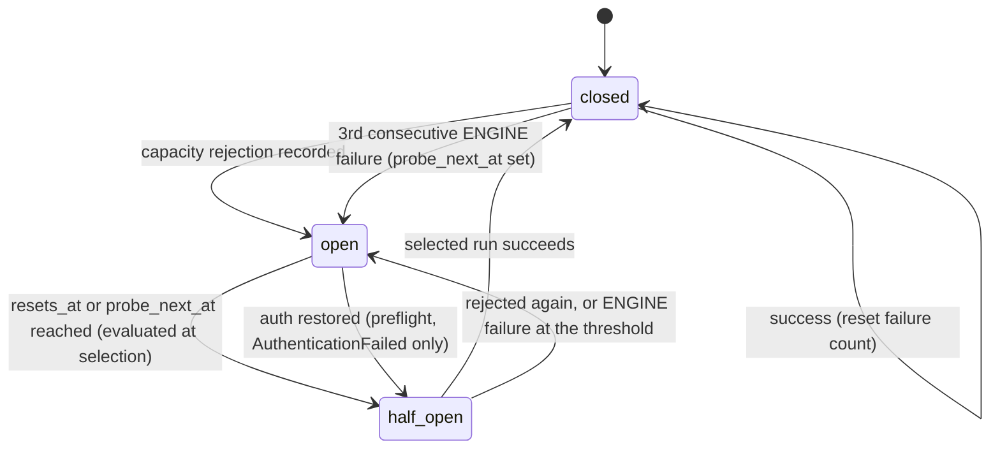

# Engine rotation: how vibey picks which AI does the next job

> [!IMPORTANT]
> **Bottom Line Up Front (BLUF):** vibey has five engines in two tiers. Local
> (`gptossloop`, on by default; `qwenloop` and `claudeloop-local`, opt-in) is always tried
> first; paid (`claudeloop`, `codexloop`) is chosen only when no local engine is eligible.
> Within a tier, smooth weighted round robin picks the engine, and circuit breakers keep a
> rate-limited engine out until its window resets and an out-of-credit engine out until a
> backoff probe. Run `vibey loops` to see the engines, their switches and what each effort
> level becomes.

> How vibey picks which AI does the next piece of work, in every phase, without
> starving an engine, without pretending they are interchangeable, and without
> conflating "out of tokens for five minutes" with "out of money until you pay."

> **How current this page is.** This plan predates the implementation. It was checked
> against `src/vibey/domain/engine.py`, `src/vibey/domain/rotation.py`,
> `src/vibey/infrastructure/engines/descriptors.py` and the runners in
> `src/vibey_runners/` on `develop` at `d91a3791e` (vibey-engine 0.4.0) on 2026-11-24.
> Where the code does not yet do what the plan designed, the text says so and marks the
> design *not implemented* instead of deleting it. The main differences from the original
> plan:
>
> - There are **five** engine ids over three runner packages (`src/vibey_runners/claude`,
>   `codex`, `qwen`, plus the shared `common`). Two are paid: `claudeloop` and `codexloop`.
>   Three are local, **preferred first** (ADR-0015, ADR-0038, ADR-0064): `gptossloop` (the
>   local runner on GPT-OSS 20B, the sovereign default and on unless switched off),
>   `qwenloop` (the same runner on a Qwen model, opt-in) and `claudeloop-local` (the
>   claudeloop binary on a local backend profile, opt-in). gptossloop's model is also the
>   sovereign DESIGN/DECOMPOSE provider (ADR-0027). `cursorloop` and `agyloop` were retired
>   and deleted by [ADR-0078](../architecture/decisions/0078-retire-cursorloop-and-agyloop.md),
>   and `opencode` with its runner after canon 8.b repealed it. Where this page still
>   describes the retired engines, it says so.
> - The effort ladder has six levels: `ULTRA` was added by
>   [ADR-0063](../architecture/decisions/0063-ultra-effort-without-a-ceiling.md) (§3).
> - The two tiers are also the family's two loops, `sovereignloop` and `paidloop` (§5.5).
> - Engine selection (SWRR) runs only for `build.implement` and `build.verify`.
>   Every other job kind runs on a single injected provider or on no engine
>   (see [phase-protocols.md](phase-protocols.md) §8).
> - `[engines] weights` is parsed but not applied (selection uses each descriptor's
>   `base_weight`), and cost-aware weighting is implemented but not wired. Circuit probes
>   are scheduled for `WindowExhausted` with a reset time and for `CreditsExhausted`
>   (§6.2); `AuthenticationFailed` deliberately gets no clock and half-opens on a passing
>   preflight. The metric exports and a `vibey rotate` command do not exist.
> - Engine failover to the sovereign engine and handback on a recorded probe
>   ([ADR-0070](../architecture/decisions/0070-failover-to-the-sovereign-engine-and-handback-on-a-recorded-probe.md))
>   is built but not wired into the worker (§7.1).
>
> This page lives under `docs/plans/`, which the published site leaves out on purpose; it is
> kept current because the agent instruction files point here.

## The idea, in one conversation

> The taxi rank outside the station had three cars waiting, and Daniel had been watching
> which one the dispatcher sent.
>
> **Daniel:** Professor, why not just send whichever engine is next in line?
>
> **Professor Feynman:** Because the cars are not the same. Suppose the rank has the
> company's own cars, which cost nothing to run, and hired cars that charge by the mile.
> Which do you send first?
>
> **Daniel:** The company's own, as long as one is free and can do the job.
>
> **Professor Feynman:** That is the tier rule: local first, paid only when no local car can
> go. Now, among the company's own cars, you do not always send the newest. Each gets a fair
> share in proportion to its size, and none is ever left at the rank all day. That is smooth
> weighted round robin.
>
> **Daniel:** And a car that is out of petrol?
>
> **Professor Feynman:** Here is the part people get wrong. A car waiting at a red light
> will move when the light changes; you know when. A car with an empty tank will not move
> until somebody pays for fuel, and no clock tells you when that will be. So vibey checks the
> first at the light change and the second only now and then, on a backoff, and never
> pretends to know. The picture stops working in one place: a taxi carries one passenger,
> and our engines can carry the same job from one to another, through the handoff gate.

## See it on your machine

1. See every engine, its tier, whether it is switched on, and its effort flags.

   ```bash
   vibey loops
   ```

   You should see `sovereignloop (tier local)` listing `gptossloop`, `qwenloop` and
   `claudeloop-local`, then `paidloop (tier paid)` listing `claudeloop` and `codexloop`.
   On a default install the `switched on` row reads `yes` for `gptossloop`, `claudeloop`
   and `codexloop`, and `no` for the other two. The rows `TRIVIAL` to `ULTRA` show the flags
   each level becomes, for example `max-turns 96` for `gptossloop` at `MAX` and
   `(no flags) -> STANDARD` for `codexloop` at `HIGH`.

2. See each engine's health and circuit on a project's database.

   ```bash
   vibey engines <project-id>
   ```

   Replace `<project-id>` with an id from `vibey projects`. You should see each engine's
   health, its circuit (`closed`, `half_open` or `open`) and its selection counts; `--json`
   prints the same facts `vibey status --json` carries under `circuits`.

## Daniel's teach-back

> **Daniel:** vibey has five engines in two tiers. It tries the local tier first and uses a
> paid engine only when no local engine is eligible. Within a tier it uses smooth weighted
> round robin, so every eligible engine gets its share and none starves. Effort is one
> six-level ladder that each engine translates into its own flags, and an engine that cannot
> reach the level asked for still runs but gets less weight. A rate limit is retried when it
> resets; empty credit is probed on a backoff, because nobody knows when it will be topped up.
>
> **Professor Feynman:** Good. One fix: the round robin runs only for BUILD's implement and
> verify jobs. DESIGN and DECOMPOSE go straight to the sovereign provider, with no rotation.

---

## 1. The verified divergence

The three runner packages, which give five engines, look like siblings: the same
`run` / `resume` / `doctor` / `stop` / `prompt` verbs, a similar run-directory layout,
and the same capacity ADT. They are *not* interchangeable at the flag level. This table
comes from reading their sources under `src/vibey_runners/`, not their docs, and from
`infrastructure/engines/descriptors.py` (checked 2026-11-24):

| Concern | `claudeloop` | `codexloop` | `gptossloop` / `qwenloop` (one runner) | `claudeloop-local` |
|---|---|---|---|---|
| Tier | paid | paid | local | local |
| Switched on by default | yes | yes | `gptossloop` yes; `qwenloop` no | no |
| Effort vocabulary | `Literal["low","medium","high","xhigh","max"]` | `StrEnum{LOW,MEDIUM,HIGH}`, no `run` flag | none (a `--max-turns` budget; `--preset`/`--effort` are accepted and ignored) | a profile's model tier, chosen by `--preset low/medium/high` (`--effort` is not forwarded on a local profile) |
| Preset tiers | `low/medium/high` → model aliases | none | none | `low/medium/high` → the profile's `model_low/medium/high` |
| Model ladder | sonnet → opus → fable | codex models | one model over an OpenAI-compatible endpoint. `gptossloop`: the Heretic v2 build of GPT-OSS 20B, `hf.co/mradermacher/gpt-oss-20b-heretic-v2-GGUF:MXFP4_MOE`, by default (ADR-0099); stock `gpt-oss:20b` is the alternative; `VIBEY_OLLAMA_MODEL` names any tag. `qwenloop`: `qwen3:14b` unless `QWENLOOP_MODEL`. Or the pinned qwen2.5-coder profiles (`[qwenloop] portable_profile` / `nvidia_profile`) | whatever the claudeloop profile names, served by Ollama |
| Top-level `effort` cmd | ✅ | ✅ | stub (prints a message) | ✅ (same binary as claudeloop) |
| Top-level `preset` cmd | ✅ | ❌ | stub | ✅ |
| `savepoints` / `unwind` | ✅ | ✅ | stubs | ✅ |
| Session listing verb | `sessions` | `threads` | `sessions` (stub) | `sessions` |
| Sandbox / permission | `permission-mode` | `sandbox` + `approval` | none (local process) | `permission-mode` |
| Structured verdict | ✅ (`finished` event) | ✅ (`run.verdict` event) | `completed` / `failed` events | claimed only when `[engines.claudeloop_local] structured_verdict = true` and conformance proves it |
| Capability snapshot (`run --capabilities PATH`, ADR-0103) | ✅ | ❌ | ✅ | ✅ |
| State dir | `.claudeloop/` | `.codexloop/` | `.qwenloop/` | `.claudeloop/` |
| Done marker | `CLAUDELOOP_TASK_FULLY_COMPLETE` | `CODEXLOOP_TASK_FULLY_COMPLETE` | `QWENLOOP_TASK_FULLY_COMPLETE` | `CLAUDELOOP_TASK_FULLY_COMPLETE` |
| Auth | `ANTHROPIC_*` | `OPENAI_API_KEY` / `CODEX_API_KEY` / login | none (local Ollama, llama.cpp or vLLM server; gptossloop reads `GPTOSSLOOP_*`, qwenloop `QWENLOOP_*`) | none (the profile scrubs the paid key) |
| Cost per million tokens in / out | $3 / $15 | $2 / $8 | $0 / $0 | $0 / $0 |
| Base weight | 3 | 2 | 1 | 1 |

**Retired.** The original table also had columns for `cursorloop` (no effort flag but a
`composer-fast → composer → grok-4.5 → grok → grok-xhigh` model ladder, router models,
`hooks` permissions, an `agents` session verb, no structured verdict, `--plan <path>`) and
`agyloop` (claudeloop's argv resolved to Gemini models, `--safe` / `--yolo`). Both runners
were deleted by [ADR-0078](../architecture/decisions/0078-retire-cursorloop-and-agyloop.md);
`EngineId("cursorloop")` and `EngineId("agyloop")` now raise `ValueError` naming the
decision, and a `vibey.toml` that lists either is refused.

vibey's descriptors list only the primary auth variable for each engine
(`ANTHROPIC_API_KEY`, `OPENAI_API_KEY`, and none for the three local engines). The
runners' own `doctor` commands also accept the alternatives shown above. Each descriptor
also declares `env_passthrough`, the variables its process may read (`CLAUDELOOP_*` and
Claude Code's, `CODEXLOOP_*` / `CODEX_*` / `OPENAI_*`, `GPTOSSLOOP_*`, `QWENLOOP_*`);
nothing else from the worker's environment reaches a session unless the project declares
it. vibey passes empty `isolation_flags` for every engine: the isolation flags the
original plan assumed do not exist on the runners' `run` verbs (the retired `agyloop`
mapped container and VM to `--safe`).

`gptossloop` and `qwenloop` are one runner under two names (ADR-0064): the
same verbs, run directory (`.qwenloop/runs/`), done marker and verdict fence,
each with its own settings and default model. `gptossloop` is on unless
`[features] gptossloop = false` or `VIBEY_FEATURE_GPTOSSLOOP=0`; `qwenloop`
exists only when `[features] qwenloop = true` is set in `vibey.toml` or
`VIBEY_FEATURE_QWENLOOP` is truthy. Their descriptors claim every `Capability`
**except** `ATTACHMENTS` and `WEB_SEARCH` (`frozenset(Capability) - {ATTACHMENTS,
WEB_SEARCH}`), because the runner's `attach` and `web-search` verbs only echo. Several other
claimed verbs (`savepoints`, `unwind`, `effort`, `slash`, `sandbox`) are echo-only stubs
too (§5.5). The runner does give its model `web_search` and `web_fetch` tools, which run
vibey's own `vibey search` and `vibey fetch` (ADR-0102); that is an affordance `vibey loops`
reports, not the `WEB_SEARCH` capability.

**The consequence:** any design that assumes `--effort high` works everywhere
breaks on `codexloop`, whose `run` verb has no `--effort` flag at all, and on
`claudeloop-local`, whose profile never forwards it. (It also broke on the retired
`cursorloop`.) Vibey handles this explicitly rather than defensively.

---

## 2. The engine descriptor

```python
@dataclass(frozen=True, slots=True)
class EngineDescriptor:
    engine_id: EngineId
    binary: str                          # "claudeloop"
    min_version: str                     # semver floor the conformance suite asserts
    state_dir: str                       # ".claudeloop"
    done_marker: str
    auth_env: tuple[str, ...]
    capabilities: frozenset[Capability]
    effort_projection: Mapping[Effort, EngineInvocation]
    session_verb: str                    # "sessions" | "threads"
    isolation_flags: Mapping[IsolationLevel, tuple[str, ...]]
    cost_per_mtok_in: float
    cost_per_mtok_out: float
    context_window: int
    base_weight: int = 1
    supports_cwd_flag: bool = True       # False for codexloop: `run` has no --cwd
    plan_flag: str | None = None         # None = positional path for every engine today
                                         # (the retired cursorloop took "--plan")
    resume_run_id_flag: str | None = None   # keeps vibey's run id on resume
    tier: EngineTier = EngineTier.PAID      # LOCAL for the three local engines
    launch_flags: tuple[str, ...] = ()      # passed to every new `run`; checked by conformance
    capabilities_flag: str | None = None    # "--capabilities": the locked snapshot (ADR-0103)
    doctor_args: tuple[str, ...] = ()       # claudeloop-local passes its --profile
    env_passthrough: tuple[str, ...] = ()   # what the engine's process may read
    affordances: EngineAffordances = EngineAffordances()   # images, files, plugins, mcp, ...
    controls: EngineControls = EngineControls()            # stop / wind-down / prompt verbs
    events: EventLog = EventLog()                          # where events.jsonl is, its shape

    def invoke(self, effort: Effort) -> EngineInvocation: ...
    def saturates_at(self, effort: Effort) -> bool: ...


@dataclass(frozen=True, slots=True)
class EngineInvocation:
    """Native flags that realize a requested vibey effort on this engine."""
    argv: tuple[str, ...]
    achieved: Effort          # may be < requested → saturation
    notes: str = ""


class Capability(StrEnum):
    SAVEPOINTS       = "savepoints"
    UNWIND           = "unwind"
    STRUCTURED_VERDICT = "structured_verdict"
    MID_RUN_PROMPT   = "mid_run_prompt"
    MID_RUN_MODEL    = "mid_run_model"
    MID_RUN_EFFORT   = "mid_run_effort"
    ATTACHMENTS      = "attachments"
    SLASH_COMMANDS   = "slash_commands"
    WEB_SEARCH       = "web_search"
    SNAPSHOT         = "snapshot"
    SANDBOX          = "sandbox"
```

`invoke(effort)` returns the projection for that level. If the level is
missing, it falls back to the highest projection at or below it.
`saturates_at(effort)` is `invoke(effort).achieved < effort`. The dataclasses
live in `domain/engine.py`.

All descriptors live in one module, `infrastructure/engines/descriptors.py`.
`DEFAULT_DESCRIPTORS = (CLAUDELOOP, CODEXLOOP)` holds the two paid engines,
`LOCAL_DESCRIPTORS = (GPTOSSLOOP, QWENLOOP, CLAUDELOOP_LOCAL)` the three local ones,
`ALL_DESCRIPTORS` all five, and `BY_ENGINE_ID` indexes them. Descriptors are **data, not
code paths**. A new engine needs a new `EngineId`, a descriptor, a capacity
classifier, an event-type map entry (§8.3), and an adapter configuration.
`domain/rotation.py` does not change. `qwenloop` and `claudeloop-local` landed this way,
and so did `gptossloop` — `QWENLOOP`'s descriptor with its own id, binary (`gptossloop`,
runner 0.3.0 or later; the runner package is 0.4.0 today) and `GPTOSSLOOP_*` passthrough.
(`opencode` landed the same way and has since been deleted; so have `cursorloop` and
`agyloop`.) The three local ones have `tier = LOCAL`, which is what the selector's tier
preference reads (§5.5).

**A known mismatch, not yet run.** The `claudeloop-local` descriptor declares
`min_version = "0.8.0"` (the claudeloop release that shipped `--profile`), but the
claudeloop package in this repository has been 0.4.0 since the #1898 version reset. The
conformance `binary` check compares `--version` with `min_version`, so it would likely
refuse claudeloop-local today. This is inferred from the code and has not been run.

---

## 3. The normalized effort ladder

Vibey's domain speaks six levels and nothing else:

```python
class Effort(IntEnum):
    TRIVIAL  = 0   # extraction, classification, formatting
    LOW      = 1   # bulk implementation — the Phase 2 default
    STANDARD = 2   # decomposition, integration, research
    HIGH     = 3   # design + review conversations — the Phase 1/3 default
    MAX      = 4   # hardest reasoning; contested specs, critical findings
    ULTRA    = 5   # effort without a ceiling (ADR-0063): chosen with `vibey ultra`,
                   # never escalated into; no turn limit
```

No ladder, triage rule or phase base reaches `ULTRA`; it is chosen for a project with
`vibey ultra start`, runs BUILD passes until `vibey ultra stop` or a budget cap, and is not
a valid `vibey.toml` effort (`VALID_EFFORTS` stops at `max`).

Each descriptor projects those onto native flags. Saturation is explicit:

```python
# claudeloop — the full range; ULTRA is the top tier with no --max-turns
{
  Effort.TRIVIAL:  EngineInvocation(("--preset","low","--effort","low"),      Effort.TRIVIAL),
  Effort.LOW:      EngineInvocation(("--preset","low","--effort","medium"),   Effort.LOW),
  Effort.STANDARD: EngineInvocation(("--preset","medium","--effort","high"),  Effort.STANDARD),
  Effort.HIGH:     EngineInvocation(("--preset","high","--effort","high"),    Effort.HIGH),
  Effort.MAX:      EngineInvocation(("--preset","high","--effort","max"),     Effort.MAX),
  Effort.ULTRA:    EngineInvocation(("--preset","high","--effort","max"),     Effort.ULTRA),
}

# codexloop — no CLI-level effort control; every level is served at STANDARD
{
  Effort.TRIVIAL:  EngineInvocation((), Effort.STANDARD),
  Effort.LOW:      EngineInvocation((), Effort.STANDARD),
  Effort.STANDARD: EngineInvocation((), Effort.STANDARD),
  Effort.HIGH:     EngineInvocation((), Effort.STANDARD),
  Effort.MAX:      EngineInvocation((), Effort.STANDARD,
                                    notes="codexloop has no CLI-level effort control"),
  Effort.ULTRA:    EngineInvocation((), Effort.STANDARD,
                                    notes="codexloop has no CLI-level effort control"),
}

# gptossloop and qwenloop — effort is a turn budget; ULTRA passes none, and the
# adapter re-invokes the runner pass after pass until Stop or a cap
{
  Effort.TRIVIAL:  EngineInvocation(("--max-turns","8"),  Effort.TRIVIAL),
  Effort.LOW:      EngineInvocation(("--max-turns","16"), Effort.LOW),
  Effort.STANDARD: EngineInvocation(("--max-turns","40"), Effort.STANDARD),
  Effort.HIGH:     EngineInvocation(("--max-turns","64"), Effort.HIGH),
  Effort.MAX:      EngineInvocation(("--max-turns","96"), Effort.MAX),
  Effort.ULTRA:    EngineInvocation((),                   Effort.ULTRA),
}

# claudeloop-local — a profile's model tier; a local model's honest ceiling is STANDARD
{
  Effort.TRIVIAL:  EngineInvocation(("--profile","local","--preset","low"),    Effort.TRIVIAL),
  Effort.LOW:      EngineInvocation(("--profile","local","--preset","low"),    Effort.LOW),
  Effort.STANDARD: EngineInvocation(("--profile","local","--preset","medium"), Effort.STANDARD),
  Effort.HIGH:     EngineInvocation(("--profile","local","--preset","high"),   Effort.STANDARD),
  Effort.MAX:      EngineInvocation(("--profile","local","--preset","high"),   Effort.STANDARD),
  Effort.ULTRA:    EngineInvocation(("--profile","local","--preset","high"),   Effort.STANDARD),
}
```

(`local` is the default `[engines.claudeloop_local] profile`.) The plan also projected
effort for two engines that no longer exist: `cursorloop` by position on a model ladder
(`--model composer-fast` … `--model grok-xhigh`) and `agyloop` with claudeloop's argv
resolved to Gemini models. Both were retired by ADR-0078. The golden files in
`tests/infrastructure/engines/golden/` (30: five engines × six efforts) pin every argv
above.

`codexloop run` has no `--effort` flag. Its internal effort starts at `MEDIUM`
and changes only through a runtime `SetEffort` event. The earlier projection
(`--effort low|medium|high`) made every real invocation fail at argument
parsing, and the conformance `flags` check caught it. Because `achieved` is
`STANDARD` at every level, a `HIGH` request on codexloop carries a
`fidelity_factor` of 0.7 and a `MAX` request carries 0.5. A `TRIVIAL` or
`LOW` request is over-served and carries 1.0.

`achieved < requested` is not an error. It lowers that engine's rotation
weight through `fidelity_factor` (§5.3). Hiding saturation would be the real
bug. Showing requested-versus-achieved effort in `vibey status` or
`vibey engines` is *not implemented*. Today the only visible sign is the
engine's smaller share of selections.

---

## 4. Phase effort policy

The user's requirement, made concrete in `domain/effort.py::PHASE_BASE_EFFORT`:

| Phase | Base effort | Rationale |
|---|---|---|
| ① DESIGN | `HIGH` | The conversation that determines what gets built. Cheapest place to spend money; most expensive place to be wrong. |
| VISUAL_DESIGN (optional) | `HIGH` | Interactive; same reasoning as DESIGN. |
| ② BUILD | `LOW` | Bulk, well-specified, verifiable work. Volume phase — this is where cost lives. |
| ③ REVIEW | `HIGH` | Judging whether the thing is right, and classifying ambiguity for the loop-back. |
| ④ DEPLOY_DESIGN | `HIGH` | Interactive deployment design. |
| ⑤ DEPLOY_EXECUTE | `LOW` | Unattended execution of an accepted deployment contract. |
| ⑥ DEPLOY_REVIEW | `HIGH` | Interactive acceptance or triage of the deployment. |

The legacy single-phase `DEPLOY` (the bridge between REVIEW and
DEPLOY_DESIGN) also maps to `LOW`.

Only BUILD's base effort feeds engine selection today, through
`application/engine_selection.py::selection_inputs_for_job`. Other phases
record an effort string in each enqueued job's requirement, but no selector
reads it (see [phase-protocols.md](phase-protocols.md) §8).

### 4.1 The Phase 2 escalation ladder

A flat `LOW` would strand the one genuinely hard item. Escalation happens
**per `build.implement` job** and follows that job's attempt number
(`domain/effort.py::BUILD_LADDER`):

```
attempt 1–2 : LOW
attempt 3–4 : STANDARD    (+ rotate engine)
attempt 5–6 : HIGH        (+ rotate engine)
attempt 7   : human gate `escalation_exhausted`
```

A tier crossing (attempts 3 and 5) forces rotation. `selection_inputs_for_job`
puts the previous attempt's engine (the job's `assigned_engine`) into the
exclusion set. `BuildImplementHandler` has its own backstop, which fails the
attempt as a `VIBEY` error if the engine matches, but it reads
`previous_engine_id` from the job payload, and only a wind-down follow-up
sets that key. A retry in
the same tier instead gives the previous engine an `affinity_factor` of 2.0.
The ladder therefore tries *different engines at higher effort* instead of
the same engine trying harder.

At attempt 7 the job parks an `escalation_exhausted` gate (ADR-0024).
Answering `vibey answer <gate-id> --raw '{"max_attempts": N}'` extends the
ladder, and further attempts run at `HIGH` until attempt `N`. Any other
answer un-parks the job, but with no `max_attempts` grant the next run parks
again on a fresh gate. The gate prompt's "fix the item by hand and answer
anything" path therefore does not, by itself, get the item to verify.

The original plan also reset the worktree from the last savepoint at
attempts 5–6 and passed every failed attempt's findings through a handoff.
Neither is implemented. Attempts do not reset the worktree, and a handoff
happens only when an engine exits with the wind-down code (§7). A gate
failure in `build.verify` does not use up implement attempts at all. It
starts a separate bounded repair loop
([phase-protocols.md](phase-protocols.md) §2.3).

### 4.2 Escalation is bounded by budget

Runaway agent cost is a documented incident class, and the ladder is exactly
the mechanism that could cause it. The cap is therefore checked *before* an
engine session starts, not after.

The caps are the project's `max_cycle_dollars` and `max_cycle_turns`, set
with `vibey new --max-cycle-dollars/--max-cycle-turns` and changed afterwards
with `vibey budget set` / `clear`, which records each change on the ledger as
`BudgetCapChanged`. When either is set, `BuildImplementHandler` compares the
cycle's ledger-recorded spend with the cap before every attempt. The caps are
read from the project's stored config at that check, not when the worker
started, so a change binds the next BUILD session of a running worker. It
parks a `budget_exhausted` gate when the cap is reached. On attempts after the
first, it also parks when the payload's `projected_cost_per_attempt` would
exceed the cap. Answering `--raw '{"max_dollars": N}'` or
`--raw '{"max_turns": N}'` raises the cap for that job only; the stored cap is
unchanged. With neither setting, spend is uncapped. The worker, `vibey cost` and
`vibey budget` read both caps through one parser,
`LedgerBudgetSource.caps_from_config`, so the cap they print is the cap the
brake enforces. The `vibey.toml` keys `max_dollars_per_cycle` and
`max_turns_per_item` are parsed into the config model, but nothing reads
them at runtime: not the brake, and not `vibey cost`.

---

## 5. The rotation algorithm

### 5.1 Why not modulo

`engines[i % len(engines)]` is the obvious implementation and is wrong here for
three reasons:

1. **The eligible set changes size** as circuits open and close. Modulo over a
   shrinking list re-maps every index, so the cursor jumps arbitrarily.
2. **It ignores weight.** A faster/cheaper/more capable engine should get more
   work, and weights are how a developer expresses that.
3. **It clumps under weight.** Naive weighted round-robin (`AAABBC`) sends three
   consecutive items to A, which is exactly the pattern that exhausts A's
   rate-limit window while B and C sit idle.

### 5.2 Smooth Weighted Round Robin

Vibey uses nginx's SWRR (ADR-0005), which produces `ABACAB` rather than
`AAABBC` for weights `{A:3, B:2, C:1}`:

```python
def select(candidates: Sequence[Candidate]) -> Selection:
    """Pure. Returns the winner and the updated candidate states."""
    if not candidates:
        raise NoEligibleEngine
    if len({c.engine_id for c in candidates}) != len(candidates):
        raise ValueError                      # engine ids must be unique
    if all(c.effective_weight == 0 for c in candidates):
        raise NoEligibleEngine
    total = sum(c.effective_weight for c in candidates)
    bumped = {c.engine_id: c.current + c.effective_weight for c in candidates}
    winner = max(candidates, key=lambda c: (bumped[c.engine_id], -c.order))  # order breaks ties
    bumped[winner.engine_id] -= total
    updated = tuple(replace(c, current=bumped[c.engine_id]) for c in candidates)
    return Selection(engine_id=winner.engine_id, candidates=updated)
```

`EngineSelector.select_engine` in `application/engine_selector.py` is the
production caller. `SelectingEngineProvider.select_for` invokes it when the
dispatcher builds a `build.implement` or `build.verify` handler.

State (`current` per engine) lives in the `rotation_cursor` table. The
selector writes it with `update_many` at dispatch time. By then the worker
has already claimed the job's lease, and the cursor write uses its own
transaction, not the lease's. A crash between selection and the engine run
can therefore advance the cursor without running anything. The lease then
expires, another worker claims the job, and selection runs again. The cost is
a small fairness skew, never a lost or duplicated job.

### 5.3 Effective weight

```
raw = base_weight × health_factor × fidelity_factor × cost_factor × affinity_factor
effective_weight = 0 if raw <= 0 else max(1, round(raw))
```

A positive raw weight never rounds down to zero. A half-open engine with a
`base_weight` of 1 (1 × 0.25) still has weight 1 and can win a probe round.
The earlier `max(0, round(raw))` rounded it to 0 and stalled forced rotation
during an unattended run.

| Factor | Range | Meaning |
|---|---|---|
| `base_weight` | ≥ 1 | Descriptor default: claudeloop 3, codexloop 2, gptossloop 1, qwenloop 1, claudeloop-local 1. `[engines] weights` in `vibey.toml` is validated but not yet applied. (The retired cursorloop and agyloop had 2 and 1.) |
| `health_factor` | 0.0–1.0 | `0.0` when open, `0.25` when half-open. When closed it is `1 − ewma_failure`: each recorded capacity rejection sets `ewma = min(1, 0.9·ewma + 0.1)`, and each success sets `ewma = 0.9·ewma`. |
| `fidelity_factor` | 0.5–1.0 | `1.0` if `achieved >= requested`; `0.7` if one tier below; `0.5` if two or more |
| `cost_factor` | 0.5–1.5 | The eligible set's median $/Mtok divided by this engine's, clamped. It is implemented as `domain/rotation.py::cost_factor` but not wired: `EngineSelector` fixes it at 1.0, and no `cost_aware` configuration key exists. |
| `affinity_factor` | 1.0 or 2.0 | `2.0` for the engine that ran this job's previous same-tier attempt, unless rotation is forced (stickiness) |

All five factors are pure functions in `domain/rotation.py` with their own
unit tests. `EngineSelector` computes health, fidelity, and affinity, and
passes cost as a constant.

### 5.4 Eligibility

```python
def eligible(
    runtimes: Sequence[EngineRuntime],
    *,
    requirement: JobRequirement,
    allow_list: frozenset[EngineId] | None = None,
) -> tuple[EngineRuntime, ...]:
    # keeps a runtime only if, in order:
    #   installed and conformance_ok and auth_valid
    #   circuit.state is not OPEN
    #   engine_id not in requirement.excluded
    #   allow_list is None or engine_id in allow_list
    #   requirement.capabilities <= descriptor.capabilities
```

`EngineSelector` precomputes `EngineRuntime.auth_valid` from the
`engine_health` row: `auth_ok_at` must be set and younger than `AUTH_TTL`
(24 hours). Startup preflight sets it, and `SelectingEngineProvider` rechecks a paid
engine's login before selection once it is past half that life -- at most once every
15 minutes per engine while the check keeps failing -- so a long-running worker never ages
its paid engines out. Before filtering, the selector also turns an `OPEN` circuit whose
`resets_at` has passed into `HALF_OPEN` (§6.2).

Note `requirement.capabilities <= descriptor.capabilities`: a job that needs
`SAVEPOINTS` is never routed to an engine whose descriptor omits it. This is
the concrete payoff of the capability matrix: the divergence in §1 becomes a
routing constraint instead of a runtime crash. No BUILD job sets a
capability requirement yet. Today the requirement carries only effort and
exclusions.

If the eligible set is empty, the job is deferred, not failed.
`SelectingEngineProvider` turns `NoEligibleEngine` into `CapacityDeferred`
with a 5-minute backoff, and the worker settles it as a capacity `Defer`.
`jobs.defer` returns the job to `ready` with `run_after = now + 5 min`,
records the reason in `last_error`, and gives back the attempt. The job
becomes claimable again once `run_after` passes. No `NOTIFY` is sent when a
circuit half-opens; half-open is evaluated lazily at the next selection.

### 5.5 The local tier, preferred first

*Was "the qwenloop standby tier"; amended 2026-09-18 by ADR-0038.*

The local engines each sit behind their own switch: `gptossloop`
(`[features] gptossloop` / `VIBEY_FEATURE_GPTOSSLOOP`), on when nothing sets it
(ADR-0064); `qwenloop` (`[features] qwenloop` / `VIBEY_FEATURE_QWENLOOP`,
ADR-0015, ADR-0064) and `claudeloop-local` (`[features] claudeloop_local` /
`VIBEY_FEATURE_CLAUDELOOP_LOCAL`, ADR-0038), off when nothing sets them. The
environment variable, when set, overrides the flag. One resolver,
`infrastructure/engines/local_engines.py::LocalEngineSettings`, answers for
bootstrap, `vibey worker`, `vibey work` and `vibey doctor`. Configuration
parsing rejects a local engine in `[engines] enabled` or a per-phase engine list
while its feature is off.

When a switch is on, `bootstrap.py` adds that engine's `LoopProcessAdapter`
(gptossloop with the `VIBEY_OLLAMA_URL` overlay of `GPTOSSLOOP_BASE_URL` and
`GPTOSSLOOP_MODEL`, qwenloop with `QWENLOOP_BASE_URL` only, claudeloop-local built from
`[engines.claudeloop_local]`) and passes the enabled ids as `local_engines` to
`SelectingEngineProvider`. Before each selection the provider preflights every
enabled local engine in its pool and refreshes its health row with
`conformance_ok = installed and auth_ok`, so a local engine needs no recorded
`vibey doctor --conformance` run.

Selection then prefers the LOCAL tier (sub-doctrine 8.a): `EngineSelector`
builds a candidate for every eligible engine, and `domain/rotation.py::
preferred_tier` offers SWRR only the candidates of the first tier in
`TIER_PREFERENCE = (LOCAL, PAID)` that holds one with a positive effective
weight. A paid engine is selected only when no local engine is eligible — or, under
hybrid dispatch, as capped overflow onto a saturated local tier (§5.6). The
provider passes its pool as the allow-list, so a stale health row for a local
engine switched off since can never be preferred.

Separately, gptossloop's model is the sovereign DESIGN and DECOMPOSE provider
(ADR-0027, ADR-0064): `vibey work` and `vibey worker` use it when no `--provider`
is given (sub-doctrine 8.b, #322) or `--provider gptossloop` is; `--provider
qwenloop` is read as gptossloop.

**The two loops.** The tiers are also the family's two loops, exactly two
(sub-doctrine 8.c; `domain/engine.py`): `Loop.SOVEREIGN = "sovereignloop"` drives every
LOCAL engine and `Loop.PAID = "paidloop"` every PAID one (`LOOP_BY_TIER`).
`DEFAULT_LOOP` is the sovereign loop, and `PAID_DEFAULT_ENGINE` is `claudeloop`, the paid
engine a paid declaration reaches unless it names another. Both constants state the canon;
the selector does not read either yet. It prefers the local tier, falls back to a paid
engine whenever no local one is eligible, and rotates paid engines by weight.
`RENAMED_ENGINES` carries one note, for `qwenloop` (it runs a Qwen model since ADR-0064;
the gpt-oss engine it used to be is `gptossloop`), and `REPEALED_FROM_LOOPS` is empty
since OpenCode was deleted.

`vibey loops` reports all of this per engine: tier, switch, cost, model, the argv for
every effort, and the descriptor's `affordances` (images, files, pasted text or images,
plugins, MCP, skills, web search, each with the code that proves it), `controls` and
`events`. Its sub-groups `marketplace`, `plugin`, `mcp`, `skills` and `snapshots` manage the
person's loop capability bundle: declared by the person, locked by content, fetched only on
their word ([ADR-0103](../architecture/decisions/0103-the-loop-capability-bundle.md)). A
BUILD run on an engine with a `capabilities_flag` (`claudeloop`, `claudeloop-local`,
`gptossloop`, `qwenloop`; not `codexloop`) is started with `run --capabilities PATH`, the
locked snapshot vibey writes into the run's own folder, and vibey records
`LoopCapabilitiesSnapshotted` first. A snapshot that cannot be resolved parks the job on a
`loop_capabilities_unresolved` gate; the run never starts without it.

### 5.6 Hybrid dispatch: paid overflow onto a saturated local tier

*Added 2026-10-03 by ADR-0079, under sub-doctrine 8.k (drafted for the operator's
ratifying merge).*

§5.5 has no notion of how busy an engine is: a local engine already running a job stays
eligible, so every BUILD job is assigned to it and queues inside Ollama. `[engines] mode`
chooses what happens then:

| Mode | Selection |
|---|---|
| `singleton` | §5.5 exactly. |
| `hybrid` | Local engines fill their declared `[engines.slots]` first (default 1 local, 2 paid). With every eligible local slot occupied, a job is **held** in the queue (a capacity defer) until it has waited `overflow_after_seconds`; then a paid engine with a free slot takes it as **overflow**, while the project's `EngineOverflowSelected` events for the UTC day are below `paid_daily_cap`. When overflow cannot happen, the job goes to local as under `singleton`. |
| `auto` (default) | `hybrid` when the latest current `EngineDispatchMeasured` event chose it, else `singleton`. |

The plan is `domain/engine_dispatch.py::EngineDispatcher.plan`, pure, over the same
candidates `EngineSelector` builds; `EngineSelector.select_dispatched` runs it and raises
`SlotHeld` for a hold before any cursor moves. `application/engine_dispatch_service.py`
supplies the counts — slots in use from the job table's unexpired leases across every
project, the job's wait from its first `EngineSlotWaitStarted` event on this attempt,
today's overflows from the ledger — and records holds, reservations and measurements
through `infrastructure/db/engine_dispatch_store.py`. A reservation recounts under the
project row's lock, so the cap is exact across workers and restarts.

`auto`'s measurement is passive (ADR-0074 applied; a live experiment would buy paid
sessions): over `auto_window_hours` of the project's BUILD history, each job's first and
last event on each local engine is a session; a session that began with every local slot
occupied is contended, and its would-wait is how long until a slot freed. `hybrid` wins
only with at least `auto_min_sessions` sessions, a contended share of at least
`auto_min_contention`, and a median contended wait of at least `overflow_after_seconds`.
The measurement is fingerprinted by the local engines and slots, the thresholds, the
algorithm and the `vibey-engine` version, and re-taken after `auto_max_age_hours`; one
that cannot be taken means `singleton`.

---

## 6. Circuit breakers

### 6.1 States and transitions



The circuit is the `circuit` column of each project's `engine_health` row.
`application/engine_health_service.py` maintains it:

- `record_capacity_rejection` opens the circuit on **every** recorded
  rejection (`CreditsExhausted`, `WindowExhausted`, or `AuthenticationFailed`)
  and increments `consecutive_fail`.
- `record_failure` records one `ENGINE`-class failure (§6.3): it increments
  `consecutive_fail` and the failure EWMA, and once `consecutive_fail`
  reaches the threshold it opens the circuit **and** sets `probe_next_at`.
  Both at once, never one without the other: an `OPEN` circuit is never
  selected, and the selector half-opens one only when a scheduled time has
  passed, so a circuit opened with no probe time could never close again. The
  same write clears `capacity_state` and `resets_at` -- the circuit is now open
  for a failure, and a stale `resets_at` would half-open it immediately.
- `record_success` closes the circuit and clears the capacity state,
  `resets_at`, `probe_next_at`, the probe attempt, and `consecutive_fail`.

The threshold and the probe backoff are `domain/circuit.py::EngineFailurePolicy`:
`ENGINE_FAILURE_THRESHOLD = 3` (the "opens after 3" `FailureClass.ENGINE` has
always promised), a first probe 5 minutes after the trip, doubling with every
further failure to a 30-minute cap -- the same 5-minute floor and 30-minute cap
as `CreditsExhausted`. Each is a field with a default; `EngineHealthService`
takes the policy as a constructor argument. `consecutive_fail` counts capacity
rejections as well as engine failures, and only a success resets it, so two
rejections followed by a crash also trip it.

`RotationRecordingHandler` wraps the `build.implement` and `build.verify`
handlers. A `Success` calls `record_success`. A capacity-classed `Defer`
calls `record_capacity_rejection` with
`WindowExhausted(resets_at=defer.retry_at)`. That is the only production
caller of `record_capacity_rejection`. A circuit opened by a `build.implement`
capacity rejection therefore half-opens once the handler's 5-minute capacity
backoff passes. Non-capacity `Defer`s, such as repair waits and lock
contention, never touch the circuit. A `Failure` whose class is `ENGINE`
calls `record_failure`; `WORK` and `VIBEY` failures record nothing.

A failure below the threshold moves only the counters. So a half-open probe
that fails with one `ENGINE` failure, on an engine whose count is still below
3, leaves the circuit `OPEN` with its old, already-passed probe time -- the
engine is probed again on the next claim rather than backed off. Re-opening
on any failed probe regardless of the count is not implemented.

### 6.2 Probe timing — where credits ≠ rate limit lives

This is the `*loop` family's hardest-won distinction, and vibey must not soften it:

| Capacity state | Designed probe | What the code does today |
|---|---|---|
| `WindowExhausted(resets_at)` | at `resets_at` (+ small jitter) | Stores `resets_at` and sets `probe_next_at` to it. The selector half-opens the circuit once that time has passed. |
| `WindowExhausted(resets_at=None)` | exponential backoff, cap 5 min | Opens the circuit with `resets_at` NULL. The selector never half-opens it automatically. |
| `CreditsExhausted` | exponential backoff from 5 min, **cap 30 min, no deadline** | Sets `probe_next_at` = now + min(5·2^attempt, 30) min and leaves `resets_at` NULL (a database CHECK enforces this). The selector half-opens on the earlier of `resets_at` and `probe_next_at`, so the engine is re-probed once the backoff elapses. |
| `AuthenticationFailed` | **never on a clock** | Opens the circuit with neither time set, because waiting cannot fix a credential. The engine stays out, visibly (`circuit=open, capacity_state=AuthenticationFailed` in `vibey status` and the dashboard), until a preflight reports `auth_ok`; `EngineHealthService` half-opens it then, so the human's re-authentication is the probe trigger. No human gate is raised. |

**Credits have no reset time.** Only a human top-up changes that, so vibey
never computes a "will be fixed at" timestamp for `CreditsExhausted`.

A circuit with no probe time at all can close only on a success, and an
`OPEN` circuit is never selected -- which is why every capacity state that a
clock or a human can clear now schedules one. The only state that schedules
neither is `AuthenticationFailed`, and its way back is a passing preflight
(worker startup or `vibey doctor --conformance --record`), which half-opens
the circuit rather than closing it. No state requires a hand-edited
`engine_health` row any more.

`domain/circuit.py::schedule_probe` encodes the intended schedule in types:
`ProbeSchedule = DeadlineProbe | BackoffProbe`, and `CreditsExhausted` can
produce only a `BackoffProbe` (5-minute floor, 30-minute cap).
`AuthenticationFailed` produces no probe, and `CreditsExhausted` itself has
no `resets_at` field. Making the rule a type error rather than a convention
is the point. `probe_next_at` is now read at selection; `schedule_probe`
itself is not yet the writer -- `EngineHealthService` still computes the same
5-minute floor / 30-minute cap inline, and folding the two together is the
remaining work.

### 6.3 Failure attribution

Not every failure is the engine's fault. A `build.implement` job that fails
because the *code* doesn't compile must not open the engine's circuit — that would
mark a healthy engine unhealthy because the project has a bug.

```
FailureClass (domain/job.py):
  CAPACITY     → circuit opens                 (provider said no)
  ENGINE       → circuit opens after 3, with a probe time (crash, kill, timeout)
  WORK         → circuit untouched             (tests failed, compile error)
  VIBEY        → circuit untouched, job retries (our bug)
```

`infrastructure/engines/classify.py::attribute_failure` implements the
classification. A WORK signal in the output tail wins over any incidental
traceback. A zero exit code is WORK. Engine markers, or exit codes 124, 137,
and -9, are ENGINE. The adapter exposes this as `attribute()`, because only
the adapter can tell a non-zero exit caused by `pytest` from one caused by
the runner dying.

Both BUILD handlers ask it. When a run ends without a completing verdict,
`build_engine_run.py::RunOutcome.incomplete_failure_class` returns `WORK` if
there is no exit code or a clean one -- what the handlers always returned --
and otherwise `engine.attribute(exit_code, "")`. So a runner killed or timed
out mid-session (137, -9, 124) is now an `ENGINE` failure against that engine,
and the failure detail names the exit code. An ordinary non-zero exit such as
1 stays `WORK`. The handlers hold no output tail, so the tail markers do not
come into it; only the exit code does. Before issue #209 both handlers
hard-coded `WORK`, and nothing in production could produce an `ENGINE`
failure at all.

---

## 7. When rotation fires

Rotation happens only when a BUILD job's handler is built, which is always at
a job boundary and never mid-turn (ADR-0007).

| Trigger | Rotates? | Forced? | Handoff? |
|---|---|---|---|
| New `build.implement` / `build.verify` job claimed | yes (SWRR) | no | no (fresh context) |
| `build.verify` for an item | yes | **yes**, excludes the implementer | no |
| Capacity rejection mid-item | yes, on the next claim | indirectly: the rejecting engine's circuit stays open until the backoff passes | no |
| Effort tier crossing (attempts 3 and 5) | yes | **yes**, excludes the previous engine | no |
| Engine exits with the wind-down code (75) | yes | **yes**, the follow-up excludes the outgoing engine | **yes** (a no-loss brief as `seed_prompt`, ADR-0004) |
| Same-tier retry (`WORK` or `ENGINE` failure) | usually **no** | — | no (affinity 2.0 favors the previous engine) |
| Phase transition | no (no selection outside BUILD) | — | no |
| Operator-forced rotation | *not implemented* (no CLI command) | — | — |
| Mid-turn | **never** | — | — |

Stickiness (the `affinity_factor` of 2.0) is why ordinary retries usually
stay on the same engine. Affinity biases SWRR but does not pin the engine,
so a retry can still move when the sticky engine's weight is low. Rotating
on every turn would mean a handoff on every turn: maximum cost, maximum
opportunity for the gate to have to work, and zero benefit. Vibey rotates
when something *changed*.

**Never mid-turn** is a hard rule. A turn is the atomic unit against a live vendor
session; interrupting one leaves the vendor's session state and vibey's ledger
disagreeing, which is the one inconsistency the whole design is built to avoid.

### 7.1 Failover to the sovereign engine (ADR-0070): built, not wired

[ADR-0070](../architecture/decisions/0070-failover-to-the-sovereign-engine-and-handback-on-a-recorded-probe.md)
adds a row the table above does not have: when a paid engine rejects on capacity, move
the work to the engine named by `[failover] target_engine` (the sovereign engine) at
`target_effort` (ULTRA), through the no-loss gate, excluding the exhausted engine; record
each probe of the paid engine (`EngineProbed`); and hand the work back, gated again, only
after a successful probe (`EngineHandedBack`; otherwise `HandbackRefused`). The pure rules
are `domain/failover.py` and the service is `application/engine_failover.py`, but
`EngineFailoverService` is constructed nowhere in `src/vibey/`, so a BUILD job does not
fail over today: a capacity rejection is still the circuit-and-defer path of the table
above. The driver session's failover (`vibey driver`) is the one that is wired. See
[handoff-protocol.md](handoff-protocol.md) §6.6.

**Exit code 78.** A runner that stops because its own backend is misconfigured (an
unreachable local server, a model not pulled, a context window too small) exits with
`EXIT_CODE_BACKEND_MISCONFIGURED = 78`. No retry or rotation fixes a configuration, so the
job parks on an `engine_misconfigured` gate instead of burning its attempts.

---

## 8. The adapter

```python
class EngineAdapter(Protocol):
    """infrastructure/engines/ — the only place vendor CLI shapes exist."""

    @property
    def descriptor(self) -> EngineDescriptor: ...

    async def preflight(self) -> PreflightResult:
        """Run `<engine> doctor`; classify auth + availability."""

    async def start(self, spec: RunSpec) -> RunHandle:
        """Build argv from descriptor.effort_projection + isolation flags,
        spawn the runner, return a handle over its run directory."""

    def tail(self, handle: RunHandle) -> AsyncIterator[EngineEvent]:
        """Stream the runner's events.jsonl, translated into vibey events."""

    async def send_prompt(self, handle: RunHandle, text: str, *, now: bool) -> None:
        """Write the runner's control-plane inbox (`prompt --now` / `--at-break`)."""

    async def stop(self, handle: RunHandle) -> StopSummary:
        """Soft-stop; collect stop-summary.md and the final snapshot."""

    async def snapshot(self, handle: RunHandle) -> SnapshotRef | None: ...

    def classify(self, raw: Mapping[str, object]) -> CapacityState:
        """Vendor error shape → vibey's capacity ADT."""

    def attribute(self, exit_code: int, tail: str) -> FailureClass: ...
```

The protocol is `application/interfaces/engines.py::EngineAdapter`. Its one
production implementation is
`infrastructure/engines/loop_process_adapter.py::LoopProcessAdapter`, which
each engine's descriptor configures. `tail` is a plain method that returns an
async iterator.

### 8.1 What the adapter actually reads

The files vibey depends on are common to all three runner packages; the rest vary:

```
.<engine>loop/runs/<run_id>/
├── meta.json          # required (conformance run_dir_shape): run_id, pid, cwd,
│                      # session_id, status, phase, attempt, waiting_until, model,
│                      # effort, preset, capacity
├── events.jsonl       # required: the runner's own event stream  ← vibey tails this
├── audit.jsonl        # claudeloop only (and the retired cursorloop)
├── bus.jsonl          # claudeloop (and the retired cursorloop and agyloop)
├── status.json        # claudeloop (and the retired cursorloop and agyloop)
├── savepoints.jsonl   # all but gptossloop and qwenloop
├── stop-summary.md    # claudeloop, codexloop (and the retired cursorloop)
├── inbox/             # ← vibey writes prompts here; claudeloop and codexloop read it
├── control/inbox/     # ← gptossloop and qwenloop read control messages here
└── snapshots/
    ├── latest.json    # required: the handoff snapshot (schema_version 1)
    └── <ts>-<reason>.json
```

`claudeloop-local` runs the claudeloop binary, so its run directory is claudeloop's,
under `.claudeloop/`.

The per-runner notes for the optional files come from which file names each
runner's sources reference. The local runner (gptossloop and qwenloop) writes only `meta.json`, `events.jsonl`,
and `snapshots/latest.json`, and it reads control messages from `control/inbox/`.
`LoopProcessAdapter.stop()` writes a soft stop to `control/inbox/*-stop.json` for
`gptossloop` and `qwenloop`, and to `<run>/inbox/` for the others, so soft stops reach
every engine. `send_prompt` still writes to `<run>/inbox/` for every engine, so a mid-run
prompt sent through the adapter does not reach the local runner today. The runner's own
`prompt` verb (`qwenloop prompt RUN_ID TEXT --cwd DIR`, the descriptor's `controls`) does
reach it at the next turn boundary.

Vibey translates `events.jsonl` into ledger events and reads `snapshots/latest.json`
for the runner's own handoff payload — which is a strict subset of what vibey's
envelope needs, and is used as *input* to brief production, not as the brief.

### 8.2 The conformance suite

The runners are pre-1.0, so each descriptor is a claim that has to be
checked. `vibey doctor --conformance` (`application/conformance.py`) asserts,
per engine:

| Check | Assertion |
|---|---|
| `binary` | installed, `--version` ≥ `min_version` |
| `flags` | every flag *name* in `effort_projection`, `isolation_flags`, and `plan_flag` appears in `run --help` (values are not checked) |
| `state_dir` | a scripted trivial run's run directory lies under `<state_dir>` |
| `run_dir_shape` | `meta.json`, `events.jsonl`, and `snapshots/latest.json` all present (polled for up to 30 s) |
| `snapshot_schema` | `latest.json.schema_version == 1` |
| `capacity_map` | each supplied fixture maps to the expected `CapacityState` (`doctor` supplies one `CreditsExhausted` fixture per engine; with no fixtures the check passes trivially) |
| `done_marker` | the descriptor's marker appears in a `VerdictRendered` payload, or `meta.json` has status `finished` |
| `control_plane` | after `send_prompt`, `<run>/inbox/` exists and is non-empty |
| `structured_verdict` | if claimed, the scripted run produced at least one `VerdictRendered` event with a mapping payload |

When the result is recorded, a failing check sets `conformance_ok = false`,
which makes the engine ineligible (§5.4): degraded, not broken.
`vibey doctor` prints exactly which claim failed, so a descriptor can be
corrected when a runner changes. By default the suite checks the two paid
engines (`DEFAULT_DESCRIPTORS`: claudeloop and codexloop), plus each local engine that is
switched on (gptossloop by default). `--engine` checks one engine. The `flags` check also
covers each descriptor's `launch_flags` and `capabilities_flag`.

This suite is what lets vibey depend on moving targets without becoming
brittle. It runs in CI against `ScriptedEngine` fakes
(`tests/application/test_conformance.py`, `tests/live/test_faked_conformance.py`).
Locally, `vibey doctor --conformance --record` runs it and saves the result
to `engine_health`. At startup, `vibey worker` warns about engines with no
recorded conformance and does not select them. There is no `vibey up`
command.

### 8.3 Event-type maps

Translation uses a per-engine string map, `LOOP_EVENT_MAP` in
`infrastructure/engines/loop_events.py`. Unmapped types are logged and
skipped, so a new runner event cannot crash vibey.

| Engine | Runner event → ledger `EventKind` |
|---|---|
| `claudeloop` | `run.started`, `preflight` → `SESSION_SEEDED`; `turn.starting` → `TURN_REQUESTED`; `turn.completed` → `TURN_COMPLETED`; `chatter.prompt`, `chatter.assistant` → `TRANSCRIPT_RECORDED`; `chatter.tool` → `TOOL_INVOKED`; `savepoint` → `SAVEPOINT_CREATED`; `capacity.forecast` → `BUDGET_SPENT`; `finished` → `VERDICT_RENDERED` (`chatter.delta` unmapped) |
| `codexloop` | `thread.started` → `SESSION_SEEDED`; `turn.started` → `TURN_REQUESTED`; `turn.completed`, `turn.failed` → `TURN_COMPLETED`; `item.started`, `item.completed` → `TOOL_INVOKED`; `rate_limits.updated` → `BUDGET_SPENT`; `run.verdict` → `VERDICT_RENDERED` |
| `gptossloop`, `qwenloop` | `run.started` → `SESSION_SEEDED`; `turn.completed` → `TURN_COMPLETED`; `text_delta` → `TRANSCRIPT_RECORDED`; `tool_result` → `TOOL_INVOKED`; `completed`, `failed` → `VERDICT_RENDERED` |
| `claudeloop-local` | claudeloop's entry, shared, not copied (the same binary writes the same events) |

`LOOP_EVENT_MAP` holds three entries (`CLAUDELOOP`, `CODEXLOOP`, `QWENLOOP`) and points
`CLAUDELOOP_LOCAL` at claudeloop's and `GPTOSSLOOP` at qwenloop's. The plan's rows for the
retired `cursorloop` (`tool_call`, `usage` only, no turn boundary) and `agyloop` (claudeloop's
map with `sdk.event` and three savepoint kinds) were removed with the engines (ADR-0078).

`capacity.forecast` and `rate_limits.updated` are headroom telemetry, emitted
while capacity is still available. They map to `BUDGET_SPENT`, never to a
capacity rejection.

**One turn, one `TURN_COMPLETED`.** The budget brake (`LedgerBudgetSource`)
counts every `TURN_COMPLETED` in a cycle against `max_cycle_turns`, so each
engine maps only its runner's own turn boundary to it. Text that rides
alongside a turn maps to `TRANSCRIPT_RECORDED`: it stays in the ledger for
replay and is never counted. That covers the `chatter.prompt` and
`chatter.assistant` echoes that claudeloop (and so claudeloop-local) writes every turn
under its default `log_chatter=summary`, and the local runner's `text_delta`, one per
streamed fragment. The local runner writes its own `turn.completed` once per model
call for exactly this reason. codexloop's `turn.failed` counts as a turn
attempt: codex ends every turn with exactly one of `turn.completed` or
`turn.failed`, and a run that fails turn after turn is the runaway the cap
exists to stop. `claudeloop`'s `chatter.delta` stays unmapped, because
`chatter.assistant` already carries the assembled text.

---

## 9. Observability of rotation

Fairness claims are worthless if unmeasured. What exists today is the
`engine_health` table, which `vibey engines [PROJECT_ID]` renders
(illustrative values):

```
ENGINE       VERSION    CIRCUIT    FAILS  SELECTED   COST
------------------------------------------------------------
claudeloop   0.4.1      closed     0      142        $18.40
codexloop    0.3.0      open       1      61         $6.12
```

The columns are `engine_id`, `version`, `circuit`, `consecutive_fail`,
`selected_count`, and `cost_usd_cycle`. Base weight, effective weight,
saturation, and the last capacity state are stored or computable but not yet
shown.

**`COST` is the engine's BUILD-session spend, and it accumulates across
cycles.** The composition root builds a `SpendMeteringLedger` for every
`build.implement` and `build.verify` job, around the BUILD ledger that job's
handler writes through. It forwards every event unchanged and sums the spend
by `domain/phase_timing.py::LedgerSpendRule` -- the same rule the budget brake
applies -- and `RotationRecordingHandler` charges the total to the selected
engine with `EngineHealthService.record_spend` when the job settles, whatever
the outcome, and even when the handler raises. Nothing resets the column,
despite its name, and DESIGN's spend is not in it. The cycle's own total,
DESIGN included, is the ledger's: `vibey cost` prints it. Until issue #209 the
column was fed only by `record_selection`'s `cost_usd` argument, which its one
caller never passed, so it read `$0.00` everywhere.

**Runtime recording; planned exports.** `bootstrap.py` constructs the
in-memory `TelemetryMetrics` recorder and the worker/rotation/handoff paths
record selections, queue latency, phase duration, handoff-gate failures, and
cost. `calculate_rotation_fairness` remains the Jain's-index helper over
selections divided by weights. No external exporter is configured yet. The
design calls for:

- `vibey_engine_selected_total{engine,phase,cycle}` — the empirical distribution;
  divide by weights and it should approach uniform.
- `vibey_engine_circuit_state{engine}` — 0 closed / 1 half-open / 2 open.
- `vibey_engine_saturation_total{engine,requested,achieved}` — how often `MAX` was
  served as `HIGH`.
- `vibey_handoff_gate_attempts` histogram, and
  `vibey_handoff_gate_violation_total{rule}` — which rules actually fire in
  practice, per engine pair.
- `vibey_engine_cost_usd{engine,phase}`.

The design also calls for a wider `vibey engines` table (planned, not built; illustrative
values):

```
ENGINE       WEIGHT  EFF  CIRCUIT    SELECTED  SAT   $/CYCLE  LAST CAPACITY
gptossloop        1  1.0  closed          203   0%      0.00  Available
claudeloop        3  3.0  closed          142   0%     18.40  Available
codexloop         2  1.4  half_open        61   9%      6.12  WindowExhausted → 14:22
claudeloop-local  1  0.0  open              9   —       0.00  AuthenticationFailed
```

---

## When it goes wrong

| What you see | What it means | What to do |
|---|---|---|
| `ConfigError: engines.enabled: unknown engine 'cursorloop' -- cursorloop was retired by ADR-0078 ...` | `vibey.toml` names a retired engine | Remove it from `[engines] enabled` and `[engines.weights]` |
| A job keeps being deferred with "claudeloop: its circuit is open, ..." | No engine is eligible; each reason comes from `rotation.py::rejections` | Fix the reason named: `vibey doctor --conformance --record` for "not conformant", log in again for "its login check is stale or failed", wait for a capacity window |
| `gptossloop` never selected | Its switch is off, or Ollama is unreachable or the model is not pulled (the runner exits 78 and the job parks on `engine_misconfigured`) | `vibey loops` shows the switch; `vibey doctor` checks the local model |
| An engine stays `open` with `AuthenticationFailed` | Waiting cannot fix a credential, so no probe is scheduled | Re-authenticate the engine, then run `vibey doctor --conformance --record` or restart the worker; a passing preflight half-opens it |
| `claudeloop-local` fails the conformance `binary` check | Its descriptor asks for claudeloop 0.8.0; the package is 0.4.0 since the version reset (inferred, §2) | Report it; the descriptor's `min_version` needs updating |

## Where next

- [phase-protocols.md](phase-protocols.md) §8, for which job kinds use rotation and which use
  a fixed provider.
- [handoff-protocol.md](handoff-protocol.md), for what happens when an engine winds down
  mid-item.
- [ADR-0038](../architecture/decisions/0038-local-engines-are-preferred-first.md) and
  [ADR-0079](../architecture/decisions/0079-hybrid-engine-dispatch.md), for why local comes
  first and when paid engines may overflow.

## Say it in one line

vibey runs each job on a local engine first and a paid one only when no local engine is
eligible, rotating fairly within a tier and never treating empty credit as a rate limit.
